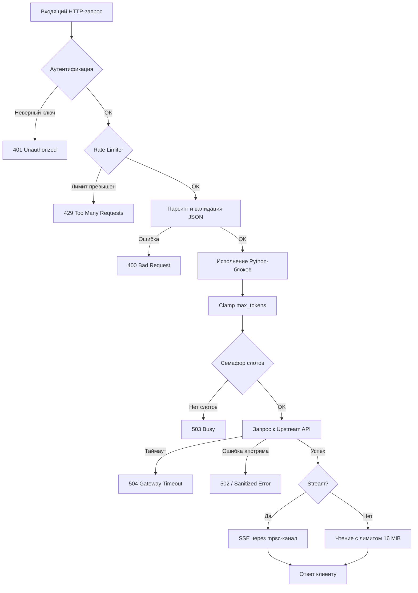

Ниже представлен комплект проектной документации, разработанный в соответствии с требованиями Единой системы программной документации (ЕСПД) ГОСТ 19.ххх. Документация адаптирована под специфику программного изделия «LLM Proxy» с учетом реализованного функционала исполнения кода и требований безопасности.

---

# 1. ТЕХНИЧЕСКОЕ ЗАДАНИЕ (ГОСТ 19.201)

## 1.1 Наименование и область применения
**Наименование:** Программный модуль проксирования запросов к большим языковым моделям «LLM Proxy» (далее — Изделие).
**Область применения:** Информационные системы, требующие защищенного доступа к API внешних LLM-провайдеров (OpenAI, OpenRouter, GenOffice), контроля расходов и выполнения вычислительных задач внутри пользовательских промптов до их отправки модели.

## 1.2 Требования к функциональным характеристикам
Изделие должно обеспечивать:
1.  **Аутентификацию клиентов** по статическому списку ключей с использованием алгоритмов сравнения за постоянное время (constant-time comparison).
2.  **Ограничение частоты запросов** (Rate Limiting) по алгоритму Token Bucket для каждого клиента индивидуально.
3.  **Контроль конкурентности** посредством семафора с отказом в обслуживании при исчерпании слотов (backpressure).
4.  **Валидацию и нормализацию** входящих JSON-запросов, включая ограничение параметров `max_tokens` и `max_completion_tokens`.
5.  **Исполнение кода:** Автоматическое обнаружение блоков `` ```python `` в сообщениях, выполнение кода во внешнем изолированном интерпретаторе и подстановка результата в тело запроса.
6.  **Проксирование ответов**, включая поддержку потоковой передачи (SSE) с механизмом backpressure.
7.  **Защиту от утечек:** Сокрытие тел ошибок аутентификации (401/403) от провайдера, запрет редиректов, валидацию базового URL.

## 1.3 Требования к надежности и безопасности
1.  Время выполнения кода в блоках `` ```python `` не должно превышать 30 секунд. По истечении таймаута процесс должен быть принудительно завершен.
2.  Интерпретатор Python должен запускаться в изолированной среде (sandbox) без доступа к сети и файловой системе хоста.
3.  Ключи провайдера (`UPSTREAM_API_KEY`) не должны передаваться клиентам, попадать в логи или тела ответов об ошибках.
4.  Размер тела входящего запроса ограничен 1 МиБ, ответа провайдера — 16 МиБ.

## 1.4 Порядок приемки
Приемка осуществляется по результатам испытаний согласно ПМИ (раздел 5 настоящего комплекта). Критерием успешной приемки является прохождение 100% тестовых сценариев раздела «Функциональные испытания» и отсутствие уязвимостей класса RCE при проверке изоляции исполняемой среды.

---

# 2. СПЕЦИФИКАЦИЯ (ГОСТ 19.202)

## 2.1 Состав программы
| Обозначение | Наименование | Примечание |
| :--- | :--- | :--- |
| LLMP-PROXY-SRC | Исходный код на языке Rust | Основной модуль |
| LLMP-PROXY-CFG | Конфигурационные параметры | Переменные окружения |
| LLMP-SANDBOX | Скрипт изолированного запуска Python | Опциональный компонент |

## 2.2 Состав документации
| Обозначение | Наименование | ГОСТ |
| :--- | :--- | :--- |
| LLMP-PROXY-TZ | Техническое задание | 19.201 |
| LLMP-PROXY-SP | Спецификация | 19.202 |
| LLMP-PROXY-VP | Ведомость держателей подлинников | 19.403 |
| LLMP-PROXY-PZ | Пояснительная записка | 19.404 |
| LLMP-PROXY-OP | Описание программы | 19.402 |
| LLMP-PROXY-TP | Текст программы | 19.401 |
| LLMP-PROXY-PMI | Программа и методика испытаний | 19.301 |
| LLMP-PROXY-RP | Руководство программиста | 19.503 |
| LLMP-PROXY-RO | Руководство оператора | 19.505 |
| LLMP-PROXY-FO | Формуляр | 19.501 |
| LLMP-PROXY-OPI | Описание применения | 19.502 |

---

# 3. ОПИСАНИЕ ПРОГРАММЫ (ГОСТ 19.402)

## 3.1 Логическая структура
Изделие построено по архитектуре асинхронного конвейера обработки запросов. Обработка разделена на фазы, упорядоченные по возрастанию вычислительной стоимости.



## 3.2 Алгоритм исполнения кода
Функция `sanitize_messages` выполняет итеративный поиск маркеров `` ```python `` в строковых полях `content`. Для каждого найденного блока:

1.  Извлекается содержимое между открывающим и закрывающим fence.
2.  Код передается в качестве аргумента `-c` процессу, указанному в `PYTHON_BIN`.
3.  Процесс создается с флагом `kill_on_drop(true)`, что гарантирует уничтожение дочернего процесса при отмене future или истечении таймаута $\tau_{max} = 30$ с.
4.  Вывод stdout заменяет исходный блок кода. При ошибке формируется диагностическое сообщение вида:
    $$ O_{err} = \texttt{[ERROR exit=}N\texttt{]}\|\texttt{stdout}\|\texttt{stderr} $$

## 3.3 Используемые методы
*   **Constant-time comparison:** Библиотека `subtle`, функция `ct_eq`. Предотвращает timing-атаки на этапе аутентификации.
*   **Token Bucket:** Емкость ведра $C = R_{pm}$, скорость пополнения $r = R_{pm}/60$ токенов/сек. Проверка доступности: $tokens(t) \geq 1$.
*   **Backpressure в SSE:** Канал `mpsc` емкостью $N=8$ чанков. При заполнении канала чтение из upstream блокируется, предотвращая рост памяти.

---

# 4. ПОЯСНИТЕЛЬНАЯ ЗАПИСКА (ГОСТ 19.404)

## 4.1 Обоснование выбора языка и фреймворка
Выбран язык Rust и фреймворк Axum по следующим причинам:
1.  **Отсутствие GC:** Детерминированное время отклика критично для прокси-сервисов.
2.  **Безопасность памяти:** Компилятор исключает data races в асинхронном коде, что подтверждается использованием `tokio::sync::Semaphore` и `Arc<Config>`.
3.  **Экосистема:** Наличие зрелых крейтов `reqwest` (HTTP/2, rustls), `serde_json` (zero-copy парсинг), `subtle` (криптографические примитивы).

## 4.2 Обоснование архитектуры исполнения кода
Исполнение кода на стороне прокси (pre-processing), а не на стороне LLM, обусловлено:
1.  **Детерминизмом:** Модель получает верифицированный результат, а не генерирует его «в уме».
2.  **Безопасностью:** Изоляция контролируется администратором инфраструктуры, а не политикой провайдера.
3.  **Стоимостью:** Результат вычисления занимает меньше токенов, чем код + рассуждения модели о нем.

## 4.3 Обоснование отказа от tokio-process
Крейт `tokio-process` исключен из зависимостей как заброшенный. Асинхронное управление процессами осуществляется через штатный модуль `tokio::process` (feature `process`), который поддерживает `kill_on_drop` и корректную интеграцию с runtime'ом.

---

# 5. ПРОГРАММА И МЕТОДИКА ИСПЫТАНИЙ (ГОСТ 19.301)

## 5.1 Объект испытаний
Программный модуль «LLM Proxy» версии 0.1.0, собранный в режиме `--release`.

## 5.2 Методика проведения испытаний

### Тест 1. Аутентификация и rate limiting
| № | Действие | Ожидаемый результат | Статус |
|---|---------|-------------------|--------|
| 1.1 | Запрос без заголовка Authorization | 401, тело без ключей | ☐ |
| 1.2 | Запрос с неверным ключом | 401, время ответа идентично п.1.3 | ☐ |
| 1.3 | Запрос с верным ключом | 200 или ошибка валидации | ☐ |
| 1.4 | 61 запрос за 1 секунду (лимит 60) | 60-й — 200, 61-й — 429 | ☐ |

### Тест 2. Исполнение Python-кода
| № | Действие | Ожидаемый результат | Статус |
|---|---------|-------------------|--------|
| 2.1 | Промпт с `` ```python\nprint(2+2)\n``` `` | В теле upstream: `` ```\n4\n``` `` | ☐ |
| 2.2 | Блок с `while True: pass` | Через 30с: `[TIMEOUT]` | ☐ |
| 2.3 | Блок с `import socket` (sandbox) | `[ERROR exit=1]` + ImportError/OSError | ☐ |
| 2.4 | `PYTHON_BIN` не задан | Блок `` ```python `` передан без изменений | ☐ |

### Тест 3. Безопасность upstream-ошибок
| № | Действие | Ожидаемый результат | Статус |
|---|---------|-------------------|--------|
| 3.1 | Upstream вернул 401 с телом, содержащим ключ | Клиент получил 502, тело: «Провайдер отклонил учётные данные прокси» | ☐ |
| 3.2 | Upstream вернул 402 с ссылкой на workspace | Ссылка заменена на `[REDACTED]` или тело скрыто | ☐ |

### Тест 4. Backpressure и лимиты
| № | Действие | Ожидаемый результат | Статус |
|---|---------|-------------------|--------|
| 4.1 | Тело запроса > 1 МиБ | 413 Payload Too Large | ☐ |
| 4.2 | Все слоты заняты | 503 Service Unavailable | ☐ |
| 4.3 | Медленный клиент при стриминге | Чтение из upstream замедляется, память стабильна | ☐ |

---

# 6. ЭКСПЛУАТАЦИОННЫЕ ДОКУМЕНТЫ

## 6.1 Руководство программиста (ГОСТ 19.503)

### Установка зависимостей
```bash
cargo add regex tokio --features process
```

### Сборка
```bash
cargo build --release
```

### Переменные окружения
| Переменная | Обяз. | По умолч. | Описание |
|-----------|:-----:|----------|----------|
| `PROXY_API_KEYS` | ✅ | — | Ключи клиентов через запятую (≥16 симв.) |
| `UPSTREAM_API_KEY` | ✅ | — | Ключ провайдера |
| `PYTHON_BIN` | | — | Путь к sandboxed-интерпретатору |
| `UPSTREAM_BASE_URL` | | `https://api.openai.com/v1` | Base URL |
| `MAX_CONCURRENT` | | 32 | Слоты конкурентности |
| `RATE_LIMIT_PER_MIN` | | 60 | Лимит запросов/мин |

## 6.2 Руководство оператора (ГОСТ 19.505)

### Запуск
```bash
./target/release/llm-proxy
```

### Мониторинг
*   Health-check: `GET /health` → `{"status":"ok"}`
*   Логи: stderr, уровень через `RUST_LOG` (info/debug/warn/error)
*   Метрики: отсутствуют в текущей версии (планируется Prometheus)

### Действия при сбоях
| Симптом | Причина | Действие |
|---------|--------|----------|
| 502 «Провайдер отклонил учётные данные» | Истек/отозван `UPSTREAM_API_KEY` | Обновить ключ, перезапустить |
| 429 для всех клиентов | Общий лимит провайдера | Увеличить баланс или снизить `RATE_LIMIT_PER_MIN` |
| `[SPAWN ERROR]` в ответах | `PYTHON_BIN` недоступен | Проверить путь и права доступа |
| Рост памяти | Утечка в sandbox | Проверить `--memory` limit в Docker/nsjail |

---

# 7. ФОРМУЛЯР (ГОСТ 19.501)

| Параметр | Значение |
|----------|----------|
| Наименование | LLM Proxy |
| Версия | 0.1.0 |
| Язык реализации | Rust 1.85+ |
| Минимальный RAM | 64 МБ (без учета sandbox) |
| Минимальный CPU | 1 vCPU |
| Сетевые порты | Настраиваемый (по умолчанию 127.0.0.1:8080) |
| Зависимости | tokio, axum, reqwest, serde_json, subtle, regex |
| Лицензия | MIT |

---

# 8. ОПИСАНИЕ ПРИМЕНЕНИЯ (ГОСТ 19.502)

Изделие предназначено для организаций, использующих LLM-API в production-среде и нуждающихся в:
1.  **Централизованном управлении ключами** — один ключ провайдера на N внутренних сервисов.
2.  **Контроле расходов** — лимиты на клиента и глобальный ceiling на `max_tokens`.
3.  **Code Interpreter без vendor lock-in** — исполнение кода на собственной инфраструктуре с полной изоляцией.
4.  **Подключении корпоративных шлюзов** (GenOffice, vLLM) через унифицированный интерфейс.

**Не применимо:** для публичных открытых прокси, для систем реального времени с латентностью <50 мс (overhead прокси ~2–5 мс), для провайдеров с нестандартным API (не OpenAI-compatible).

---

# 9. ВЕДОМОСТЬ ДЕРЖАТЕЛЕЙ ПОДЛИННИКОВ (ГОСТ 19.403)

| Обозначение документа | Наименование | Держатель подлинника | Экз. |
|----------------------|-------------|---------------------|------|
| LLMP-PROXY-TZ | Техническое задание | Архив проекта | 1 |
| LLMP-PROXY-SP | Спецификация | Архив проекта | 1 |
| LLMP-PROXY-TP | Текст программы | Репозиторий Git | 1 |
| LLMP-PROXY-PMI | Программа и методика испытаний | QA-отдел | 1 |
| LLMP-PROXY-RP | Руководство программиста | DevOps-отдел | 1 |
| LLMP-PROXY-RO | Руководство оператора | Эксплуатация | 1 |

---

# 10. ТЕЗАУРУС И РАСШИФРОВКА АББРЕВИАТУР

| Аббревиатура / Термин | Расшифровка / Определение |
|----------------------|--------------------------|
| **LLM** | Large Language Model — большая языковая модель |
| **SSE** | Server-Sent Events — протокол односторонней потоковой передачи данных поверх HTTP |
| **RCE** | Remote Code Execution — удалённое выполнение кода, класс уязвимостей |
| **SSRF** | Server-Side Request Forgery — подделка запросов на стороне сервера |
| **Backpressure** | Механизм обратного давления, при котором медленный потребитель замедляет производителя данных |
| **Token Bucket** | Алгоритм ограничения скорости, основанный на концепции «ведра токенов» с равномерным пополнением |
| **Constant-time** | Выполнение операции за фиксированное время независимо от входных данных (защита от timing-атак) |
| **Fence** | Маркер fenced code block в Markdown (тройные обратные кавычки `` ``` ``) |
| **Upstream** | Внешний LLM-провайдер, к которому прокси перенаправляет запросы |
| **Clamp** | Ограничение значения параметра сверху заданным потолком |
| **kill_on_drop** | Флаг tokio::process, гарантирующий SIGKILL дочернему процессу при уничтожении объекта Child |
| **ЕСПД** | Единая система программной документации (ГОСТ 19.ххх) |
| **ПМИ** | Программа и методика испытаний |
| **ТЗ** | Техническое задание |
