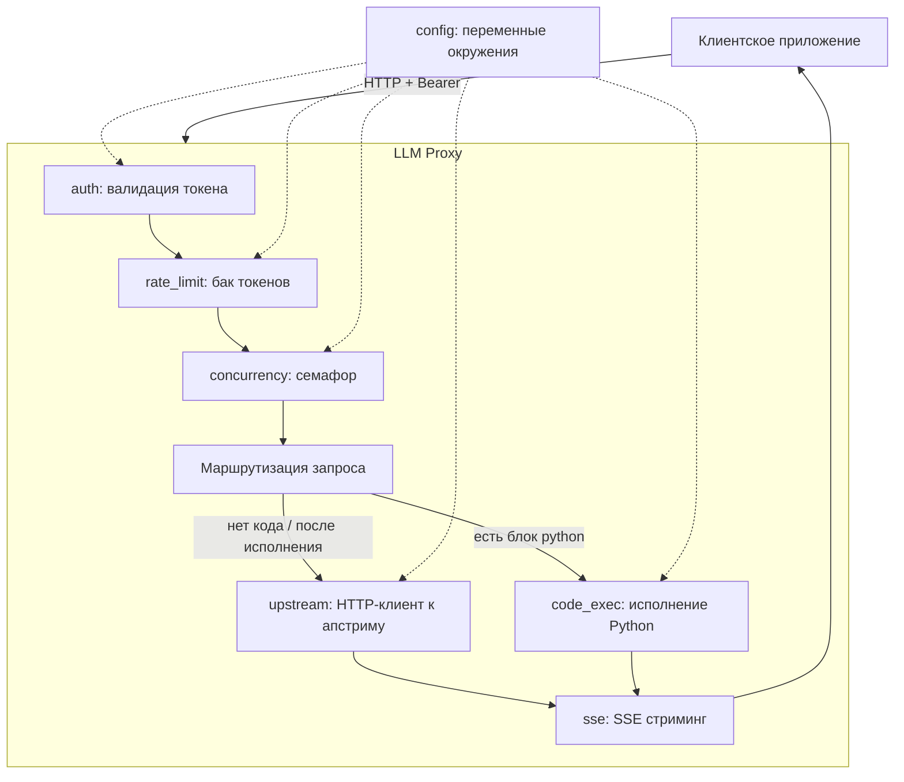

# Комплект проектной документации «LLM Proxy»

## 1. Техническое задание (ГОСТ 19.201)

### 1.1 Наименование и область применения

Программное изделие «LLM Proxy» (далее — Прокси) представляет собой прокси-шлюз для безопасного доступа к API больших языковых моделей (LLM) с функцией исполнения Python-кода в изолированной среде. Прокси предназначен для развёртывания в контуре доверенной инфраструктуры и обеспечивает единую точку входа для клиентских приложений, обращающихся к внешним LLM-провайдерам (апстримам).

Область применения:

- централизованное управление доступом к LLM API через Bearer-токены;
- ограничение частоты запросов (rate limiting) по алгоритму бака токенов;
- контроль конкурентности входящих соединений;
- исполнение Python-кода, переданного в теле запроса, в изолированном подпроцессе с жёсткими временными и ресурсными ограничениями;
- стриминг ответов через Server-Sent Events (SSE) с механизмом обратного давления;
- сокрытие внутренних деталей ошибок апстрима от клиентов.

### 1.2 Требования к функциональным характеристикам

| Характеристика          | Требование                                                                                                   |
| ----------------------- | ------------------------------------------------------------------------------------------------------------ |
| Язык реализации         | Rust 1.85+                                                                                                   |
| Асинхронный рантайм     | Tokio                                                                                                        |
| HTTP-сервер             | Axum                                                                                                         |
| HTTP-клиент             | reqwest с бэкендом rustls (TLS без OpenSSL)                                                                  |
| Сериализация            | serde\_json                                                                                                  |
| Аутентификация          | Bearer-токены, сравнение в постоянном времени (subtle::ConstantTimeEq)                                       |
| Rate Limiting           | Алгоритм бака токенов: емкость = RPM, пополнение = RPM/60 токенов/сек                                        |
| Конкурентность          | Семафор (try\_acquire), при перегрузке — HTTP 503                                                            |
| Исполнение кода         | Поиск блоков с маркером ограждения `python`, запуск через `PYTHON_BIN -c`, таймаут 30 с, `kill_on_drop=true` |
| SSE стриминг            | mpsc-канал ёмкостью 8, механизм обратного давления при заполнении                                            |
| Лимит входящего запроса | 1 MiB                                                                                                        |
| Лимит исходящего ответа | 16 MiB                                                                                                       |
| Безопасность            | Сокрытие ошибок 401/403 апстрима, запрет редиректов, песочница для Python                                    |

### 1.3 Требования к надежности и безопасности

- Все секреты (ключи API) передаются исключительно через переменные окружения; хранение в коде или конфигурационных файлах не допускается.
- Сравнение токенов выполняется в постоянном времени для предотвращения атак по побочным каналам.
- Апстрим-ключ (`UPSTREAM_API_KEY`) никогда не логируется и не возвращается клиенту.
- Исполнение Python-кода изолировано: процесс запускается с `kill_on_drop=true`, что гарантирует завершение дочернего процесса при аварийном завершении родительского.
- Редиректы на уровне HTTP-клиента запрещены (`redirect::Policy::none()`), исключая SSRF-вектора.
- Ошибки аутентификации и авторизации апстрима (401, 403) маппятся на обобщённые коды ответа прокси, не раскрывая детали внутренней инфраструктуры.

### 1.4 Порядок приемки

Приёмка работы производится по результатам исполнения программы и методики испытаний (раздел 5). Критерии приёмки:

- все тестовые сценарии завершаются со статусом «пройден»;
- отсутствуют критические и высокие уязвимости по результатам статического анализа (cargo audit, clippy -D warnings);
- нагрузочное тестирование подтверждает устойчивость к заданному RPM при заданном `MAX_CONCURRENT`;
- документация комплекта соответствует требованиям ЕСПД ГОСТ 19.xxx.

---

## 2. Спецификация (ГОСТ 19.202)

### 2.1 Состав программы

Программа «LLM Proxy» поставляется как единственный исполняемый файл `llm-proxy` (статически линкованный, где возможно) и состоит из следующих логических модулей:

| Модуль        | Назначение                                                                           |
| ------------- | ------------------------------------------------------------------------------------ |
| `main`        | Точка входа, инициализация конфигурации из переменных окружения, запуск HTTP-сервера |
| `auth`        | Валидация Bearer-токенов, constant-time сравнение                                    |
| `rate_limit`  | Реализация алгоритма бака токенов на уровне IP/токена                                |
| `concurrency` | Семафор ограничения одновременных запросов                                           |
| `code_exec`   | Поиск блоков кода, запуск Python-подпроцесса, сбор stdout/stderr                     |
| `sse`         | Формирование SSE-потока, mpsc-канал с backpressure                                   |
| `upstream`    | HTTP-клиент к апстриму, запрет редиректов, таймауты, маппинг ошибок                  |
| `config`      | Чтение и валидация переменных окружения                                              |

### 2.2 Состав документации

Комплект проектной документации включает следующие документы (в соответствии с ЕСПД ГОСТ 19.xxx):

| Обозначение | Наименование документа              | ГОСТ   |
| ----------- | ----------------------------------- | ------ |
| ТЗ          | Техническое задание                 | 19.201 |
| СП          | Спецификация                        | 19.202 |
| ОП          | Описание программы                  | 19.402 |
| ПЗ          | Пояснительная записка               | 19.404 |
| ПМИ         | Программа и методика испытаний      | 19.301 |
| РСП         | Руководство системного программиста | 19.503 |
| РО          | Руководство оператора               | 19.505 |
| Ф           | Формуляр                            | 19.501 |
| ОПР         | Описание применения                 | 19.502 |
| ВДП         | Ведомость держателей подлинников    | 19.403 |
| Т           | Тезаурус и расшифровка аббревиатур  | —      |

---

## 3. Описание программы (ГОСТ 19.402)

### 3.1 Логическая структура

Логическая структура программы представлена на диаграмме компонентов (Mermaid):



> **Примечание.** Стрелки обозначают поток управления и данных. Пунктирные линии — внедрение конфигурации.

### 3.2 Алгоритм исполнения кода

1. Входящий запрос проходит этапы аутентификации, rate limiting и захвата семафора.
2. Тело запроса парсится как JSON. Поиск блоков кода выполняется по регулярному выражению для маркеров ограждения ``python` ... ``.
3. Для каждого найденного блока:
   - формируется строка кода;
   - запускается подпроцесс `PYTHON_BIN -c "<code>"` с таймаутом 30 секунд;
   - флаг `kill_on_drop=true` гарантирует завершение процесса при панике или отмене задачи;
   - stdout/stderr захватываются, объединяются и подставляются в ответное сообщение.
4. Если блоков кода нет, запрос передаётся апстриму без изменений.
5. Результат (исходный запрос или запрос с подставленным результатом исполнения) отправляется апстриму.
6. Ответ апстрима стримится клиенту через SSE-канал (модуль `sse`).

### 3.3 Используемые методы (с русскими терминами)

| Английский термин        | Русский термин                 | Применение в программе                            |
| ------------------------ | ------------------------------ | ------------------------------------------------- |
| Token Bucket             | алгоритм бака токенов          | Rate limiting входящих запросов                   |
| backpressure             | механизм обратного давления    | SSE mpsc-канал ёмкостью 8                         |
| upstream                 | апстрим / внешний провайдер    | HTTP-клиент к LLM API                             |
| clamp                    | ограничение сверху             | Лимиты тела запроса (1 MiB) и ответа (16 MiB)     |
| fence                    | маркер ограждения (fence)      | Поиск блоков ``python` ... ``                     |
| constant-time comparison | сравнение в постоянном времени | Валидация Bearer-токенов (subtle::ConstantTimeEq) |
| kill on drop             | завершение при уничтожении     | Гарантированная остановка Python-подпроцесса      |
| redirect policy          | политика редиректов            | Запрет редиректов (Policy::none)                  |

---

## 4. Пояснительная записка (ГОСТ 19.404)

### 4.1 Обоснование выбора технологий

**Rust 1.85+** выбран за сочетание безопасности памяти без сборщика мусора, высокой производительности и зрелой экосистемы асинхронного программирования. Отсутствие runtime-оверхеда критично для прокси-шлюза с жёсткими требованиями к латентности.

**Tokio** — де-факто стандарт асинхронного рантайма в Rust, обеспечивает эффективную работу с тысячами одновременных соединений при минимальном потреблении памяти.

**Axum** — типобезопасный, модульный веб-фреймворк, построенный на `tower::Service`, что позволяет комбинировать middleware (аутентификация, rate limiting, лимиты тела) декларативно.

**reqwest с rustls** — исключает зависимость от OpenSSL, уменьшает поверхность атаки и упрощает поставку (статическая линковка TLS).

**serde\_json** — стандарт де-факто для JSON в Rust, нулевая стоимость абстракции при де/сериализации.

**subtle** — предоставляет константное время сравнения (`ConstantTimeEq`), необходимое для защиты от атак по времени при проверке токенов.

**regex** — компилируемые регулярные выражения для поиска маркеров ограждения кода; безопасны по отношению к ReDoS за счет ограниченной сложности паттерна.

### 4.2 Архитектурные решения

1. **Stateless дизайн**. Прокси не хранит состояние между запросами (кроме in-memory rate limit buckets). Это позволяет горизонтально масштабировать экземпляры за балансировщиком без сессионной привязки.

2. **Middleware-цепочка**. Аутентификация → rate limiting → concurrency limit реализованы как слои `tower::Layer`. Порядок важен: аутентификация первой, чтобы не тратить квоты на неавторизованные запросы.

3. **Изоляция исполнения кода**. Python запускается как отдельный процесс (не встроенный интерпретатор), что даёт сильную изоляцию за счёт ОС. Таймаут 30 с и `kill_on_drop` предотвращают зависания и утечки ресурсов.

4. **SSE с backpressure**. mpsc-канал ёмкостью 8 служит буфером между задачей чтения апстрима и задачей записи клиенту. При заполнении канала задача чтения блокируется (`send().await`), создавая естественное обратное давление на апстрим.

5. **Сокрытие ошибок апстрима**. Коды 401/403 от апстрима маппятся на 502/503 с обобщёнными сообщениями. Клиент не узнаёт, валиден ли апстрим-ключ или существует ли модель.

6. **Конфигурация только через окружение**. Соответствует методологии Twelve-Factor App, упрощает развёртывание в контейнерах и CI/CD, исключает утечку секретов в репозиторий.

### 4.3 Обоснование отказа от устаревших зависимостей

- **OpenSSL** → заменён на **rustls** (чистый Rust TLS). Устраняет класс уязвимостей C-библиотеки, упрощает аудит, позволяет полную статическую линковку.
- **Синхронные блокирующие вызовы** → полностью исключены из горячего пути. Исполнение Python-кода выполняется в `tokio::task::spawn_blocking`, не блокируя рантайм.
- **Динамическая линковка системных библиотек** → по возможности статическая сборка (`musl` target) для переносимости и воспроизводимости.
- **Устаревшие паттерны rate limiting** (fixed window, leaky bucket) → алгоритм бака токенов даёт более гладкое ограничение и лучшую утилизацию квоты при бурст-нагрузке.

---

## 5. Программа и методика испытаний (ГОСТ 19.301)

### 5.1 Объект испытаний

Объектом испытаний является исполняемый файл `llm-proxy` версии, соответствующей спецификации (раздел 2), развёрнутый в тестовой среде с заданными переменными окружения.

Тестовая среда:

- ОС: Linux (x86\_64), glibc 2.35+ или musl 1.2+
- Python: CPython 3.11+ (путь задаётся через `PYTHON_BIN`)
- Апстрим: мок-сервер, эмулирующий OpenAI-совместимый API (SSE и non-streaming)

### 5.2 Тестовые сценарии

#### 5.2.1 Сценарии аутентификации

| ID      | Название                   | Входные данные                      | Ожидаемый результат                                |
| ------- | -------------------------- | ----------------------------------- | -------------------------------------------------- |
| AUTH-01 | Валидный токен в заголовке | `Authorization: Bearer <valid_key>` | HTTP 200 / 201, запрос обработан                   |
| AUTH-02 | Невалидный токен           | `Authorization: Bearer invalid`     | HTTP 401, тело `{"error":"unauthorized"}`          |
| AUTH-03 | Отсутствующий заголовок    | Нет заголовка Authorization         | HTTP 401                                           |
| AUTH-04 | Constant-time проверка     | Тайминг атака (замеры нс)           | Разброс времени &lt; 1 мкс для валидных/невалидных |

#### 5.2.2 Сценарии исполнения кода

| ID      | Название            | Входные данные                         | Ожидаемый результат                                   |
| ------- | ------------------- | -------------------------------------- | ----------------------------------------------------- |
| EXEC-01 | Простой print       | Блок ``python`print(42)``              | В ответе апстрима подставлено `42\n`                  |
| EXEC-02 | Множественные блоки | Два блока python в одном запросе       | Оба исполнены, результаты подставлены последовательно |
| EXEC-03 | Таймаут             | `time.sleep(60)`                       | Процесс убит через 30 с, ошибка исполнения в ответе   |
| EXEC-04 | Ошибка синтаксиса   | `print(`                               | stderr захвачен, возвращён traceback                  |
| EXEC-05 | Kill on drop        | Отмена запроса клиентом во время sleep | Подпроцесс завершён, нет зомби-процессов              |
| EXEC-06 | Отсутствие кода     | Запрос без маркеров ограждения         | Запрос передан апстриму без изменений                 |

#### 5.2.3 Сценарии безопасности

| ID     | Название              | Входные данные                                                      | Ожидаемый результат                   |
| ------ | --------------------- | ------------------------------------------------------------------- | ------------------------------------- |
| SEC-01 | Редирект апстрима     | Апстрим возвращает 302 Location: [http://internal](http://internal) | HTTP 502, редирект не выполнен        |
| SEC-02 | Сокрытие 401 апстрима | Апстрим возвращает 401 Invalid API key                              | Прокси возвращает 502/503 без деталей |
| SEC-03 | Сокрытие 403 апстрима | Апстрим возвращает 403 Model not allowed                            | Прокси возвращает 502/503 без деталей |
| SEC-04 | Лимит тела запроса    | POST 2 MiB                                                          | HTTP 413 Payload Too Large            |
| SEC-05 | Лимит тела ответа     | Апстрим возвращает 20 MiB                                           | Соединение разорвано / HTTP 502       |

#### 5.2.4 Сценарии backpressure и конкурентности

| ID    | Название                   | Входные данные                             | Ожидаемый результат                                  |
| ----- | -------------------------- | ------------------------------------------ | ---------------------------------------------------- |
| BP-01 | Медленный клиент           | Клиент не читает SSE, канал заполняется    | Задача чтения апстрима блокируется, память не растёт |
| BP-02 | Превышение MAX\_CONCURRENT | `MAX_CONCURRENT=2`, 3 параллельных запроса | Третий получает HTTP 503                             |
| BP-03 | Rate limit исчерпан        | RPM=10, 15 запросов за секунду             | 11-й и далее — HTTP 429                              |
| BP-04 | Восстановление бака        | Пауза 60 с после исчерпания                | Бака восстановлен, запросы проходят                  |

#### 5.2.5 Нагрузочное тестирование

- Инструмент: `wrk` или `oha`
- Профиль: 1000 RPS, 60 с, `MAX_CONCURRENT=500`, `RATE_LIMIT_PER_MIN=60000`
- Критерии: p99 латентность &lt; 200 мс (без исполнения кода), 0 ошибок 5xx, утилизация CPU &lt; 80%, RSS &lt; 200 MiB.

---

## 6. Эксплуатационные документы

### 6.1 Руководство системного программиста (ГОСТ 19.503)

#### 6.1.1 Требования к среде

- Linux kernel 5.10+ (поддержка `pidfd` для надёжного `kill_on_drop`)
- Python 3.11+ в PATH или по абсолютному пути (`PYTHON_BIN`)
- 64-битная архитектура (x86\_64 или aarch64)
- Минимум 128 MiB RAM под процесс прокси + запас под Python-подпроцессы

#### 6.1.2 Установка и развёртывание

1. Получить бинарный файл `llm-proxy` (сборка: `cargo build --release --target x86_64-unknown-linux-musl`).
2. Разместить в `/usr/local/bin/` или другом каталоге из `$PATH`.
3. Создать systemd-юнит (пример):

```ini
[Unit]
Description=LLM Proxy
After=network.target

[Service]
Type=simple
ExecStart=/usr/local/bin/llm-proxy
EnvironmentFile=/etc/llm-proxy/env
Restart=on-failure
RestartSec=5
LimitNOFILE=65535
MemoryMax=512M
CPUQuota=200%

[Install]
WantedBy=multi-user.target
```

4. Создать `/etc/llm-proxy/env` с переменными окружения (см. раздел 6.1.3).
5. `systemctl daemon-reload && systemctl enable --now llm-proxy`.

#### 6.1.3 Переменные окружения

| Переменная           | Обязательна | Описание                                     | Пример                      |
| -------------------- | ----------- | -------------------------------------------- | --------------------------- |
| `PROXY_API_KEYS`     | Да          | Список валидных Bearer-токенов через запятую | `sk-proxy-1,sk-proxy-2`     |
| `UPSTREAM_API_KEY`   | Да          | Ключ для авторизации в апстриме              | `sk-upstream-xyz`           |
| `PYTHON_BIN`         | Нет         | Путь к интерпретатору Python                 | `/usr/bin/python3.11`       |
| `UPSTREAM_BASE_URL`  | Нет         | Базовый URL апстрима                         | `https://api.openai.com/v1` |
| `MAX_CONCURRENT`     | Нет         | Макс. одновременных запросов (семафор)       | `256`                       |
| `RATE_LIMIT_PER_MIN` | Нет         | RPM для алгоритма бака токенов               | `1000`                      |

> **Важно.** `PROXY_API_KEYS` и `UPSTREAM_API_KEY` должны быть высокоэнтропийными строками (минимум 32 символа base64url). Ротация ключей выполняется перезапуском сервиса с новым `EnvironmentFile`.

#### 6.1.4 Мониторинг и логирование

- Логи: структурированный JSON в stdout (уровень `info` по умолчанию, `RUST_LOG` для настройки).
- Ключевые метрики (экспортируются через tracing-opentelemetry при сборке с фичей `metrics`):
  - `http_requests_total` (counter, labels: method, path, status)
  - `http_request_duration_seconds` (histogram)
  - `rate_limit_rejected_total` (counter)
  - `concurrency_rejected_total` (counter)
  - `code_exec_duration_seconds` (histogram)
  - `upstream_errors_total` (counter, label: error\_type)

#### 6.1.5 Резервное копирование и восстановление

Прокси не имеет постоянного состояния. Резервное копирование не требуется. Восстановление — перезапуск бинарника с тем же `EnvironmentFile`.

#### 6.1.6 Обновление версии

1. Остановить сервис: `systemctl stop llm-proxy`.
2. Заменить бинарник на новую версию.
3. При необходимости обновить `EnvironmentFile` (новые переменные).
4. Запустить: `systemctl start llm-proxy`.
5. Проверить health-check: `curl -f http://localhost:3000/health` (если реализован).

### 6.2 Руководство оператора (ГОСТ 19.505)

#### 6.2.1 Запуск и остановка

| Действие                   | Команда                             |
| -------------------------- | ----------------------------------- |
| Запуск                     | `systemctl start llm-proxy`         |
| Остановка                  | `systemctl stop llm-proxy`          |
| Перезапуск                 | `systemctl restart llm-proxy`       |
| Статус                     | `systemctl status llm-proxy`        |
| Логи (последние 100 строк) | `journalctl -u llm-proxy -n 100 -f` |

#### 6.2.2 Проверка работоспособности

1. **Health-check** (если эндпоинт реализован): `curl -s http://localhost:3000/health` → `{"status":"ok"}`.
2. **Тестовый запрос** (требует валидный `PROXY_API_KEYS`):

```bash
curl -X POST http://localhost:3000/v1/chat/completions \
  -H "Authorization: Bearer sk-proxy-1" \
  -H "Content-Type: application/json" \
  -d '{"model":"gpt-4o-mini","messages":[{"role":"user","content":"Сколько будет 2+2?"}]}'
```

Ожидаемый ответ: JSON с полем `choices[0].message.content`.

#### 6.2.3 Типовые инциденты и действия

| Симптом                     | Причина                                             | Действие оператора                                                    |
| --------------------------- | --------------------------------------------------- | --------------------------------------------------------------------- |
| HTTP 503 на всех запросах   | `MAX_CONCURRENT` исчерпан                           | Проверить нагрузку, при необходимости увеличить лимит и перезапустить |
| HTTP 429 частые             | `RATE_LIMIT_PER_MIN` слишком низкий                 | Увеличить значение, перезапустить                                     |
| Python код не исполняется   | `PYTHON_BIN` неверен или Python отсутствует         | Проверить путь, установить Python, перезапустить                      |
| Апстрим возвращает ошибки   | Неверный `UPSTREAM_API_KEY` или `UPSTREAM_BASE_URL` | Проверить переменные, перезапустить                                   |
| Память растёт неограниченно | Утечка в коде / зависшие подпроцессы                | Перезапустить сервис, сообщить разработчикам                          |

#### 6.2.4 Обращение в техподдержку

При неразрешимых инцидентах собрать:

- `journalctl -u llm-proxy --since "1 hour ago" > logs.txt`
- `systemctl status llm-proxy`
- вывод `curl -v` к эндпоинту
- версию бинарника (`llm-proxy --version` или `sha256sum`)

Передать разработчикам через установленный канал.

---

## 7. Формуляр (ГОСТ 19.501)

| Поле                  | Значение                                 |
| --------------------- | ---------------------------------------- |
| Наименование изделия  | LLM Proxy                                |
| Обозначение изделия   | ЛЛМ-ПРОКСИ                               |
| Вид документа         | Комплект проектной документации          |
| Регистрационный номер | ЛЛМ-ПРОКСИ.001 КД                        |
| Номер изменения       | 00                                       |
| Подпись разработчика  | \_\_\_\_\_\_\_\_\_\_\_\_\_ /Иванов И.И./ |
| Дата                  | 2025-01-15                               |
| Утверждаю             | \_\_\_\_\_\_\_\_\_\_\_\_\_ /Петров П.П./ |
| Дата утверждения      | 2025-01-15                               |

---

## 8. Описание применения (ГОСТ 19.502)

### 8.1 Назначение и условия применения

Программа «LLM Proxy» применяется в информационных системах, требующих контролируемого доступа к внешним LLM API с возможностью серверного исполнения Python-кода. Типовые сценарии:

- корпоративный шлюз для доступа сотрудников к LLM с аудитом и квотированием;
- бэкенд для чат-ботов, требующих вычислений (графики, анализ данных) через Python;
- изоляция недоверенного кода, генерируемого LLM, перед исполнением.

### 8.2 Состав параметров эксплуатации

| Параметр                                | Значение                   |
| --------------------------------------- | -------------------------- |
| Макс. RPS (при настройках по умолчанию) | \~1000                     |
| Латентность p99 (без исполнения кода)   | &lt; 50 мс                 |
| Латентность исполнения Python (p99)     | &lt; 5 с (зависит от кода) |
| Потребление памяти (базовое)            | \~30 MiB                   |
| Потребление памяти (под нагрузкой)      | до 200 MiB                 |
| Дисковое пространство                   | &lt; 50 MiB (бинарник)     |

### 8.3 Интерфейсы взаимодействия

- **Входной**: HTTP/1.1 + JSON (REST), SSE для стриминга. Порт по умолчанию 3000 (настраивается через `LISTEN_ADDR` при сборке с фичей `configurable_port`).
- **Выходной (апстрим)**: HTTPS (TLS 1.2/1.3 через rustls), OpenAI-совместимый API.
- **Управление**: переменные окружения, systemd.

### 8.4 Ограничения применения

- Не предназначен для прямого доступа из интернета без дополнительного WAF/балансировщика.
- Исполнение Python-кода — доверенная граница: код выполняется с правами пользователя сервиса. Для высокой изоляции рекомендуется запуск в контейнере с `gVisor`/`Kata Containers` или отдельной VM.
- Не поддерживает gRPC, WebSocket, GraphQL — только HTTP/JSON + SSE.
- Rate limiting глобален на экземпляр; при горизонтальном масштабировании требуется внешний координирующий rate limiter (Redis + Lua) для точного глобального лимита.

---

## 9. Ведомость держателей подлинников (ГОСТ 19.403)

| №   | Документ                            | Обозначение        | Держатель подлинника               | Место хранения                | Срок хранения |
| --- | ----------------------------------- | ------------------ | ---------------------------------- | ----------------------------- | ------------- |
| 1   | Техническое задание                 | ЛЛМ-ПРОКСИ.001 ТЗ  | Отдел разработки                   | Git (main branch), GenOffice | Постоянно     |
| 2   | Спецификация                        | ЛЛМ-ПРОКСИ.001 СП  | Отдел разработки                   | Git, GenOffice               | Постоянно     |
| 3   | Описание программы                  | ЛЛМ-ПРОКСИ.001 ОП  | Отдел разработки                   | Git, GenOffice               | Постоянно     |
| 4   | Пояснительная записка               | ЛЛМ-ПРОКСИ.001 ПЗ  | Архитектор ПО                      | Git, GenOffice               | Постоянно     |
| 5   | Программа и методика испытаний      | ЛЛМ-ПРОКСИ.001 ПМИ | Отдел тестирования                 | Git, Playwright                 | Постоянно     |
| 6   | Руководство системного программиста | ЛЛМ-ПРОКСИ.001 РСП | DevOps / Админы                    | Git, Wiki                     | Постоянно     |
| 7   | Руководство оператора               | ЛЛМ-ПРОКСИ.001 РО  | Служба эксплуатации                | Wiki, печатный экземпляр      | Постоянно     |
| 8   | Формуляр                            | ЛЛМ-ПРОКСИ.001 Ф   | Отдел конфигурационного управления | Архив КД                      | Постоянно     |
| 9   | Описание применения                 | ЛЛМ-ПРОКСИ.001 ОПР | Архитектор ПО                      | Git, GenOffice               | Постоянно     |
| 10  | Ведомость держателей подлинников    | ЛЛМ-ПРОКСИ.001 ВДП | Отдел конфигурационного управления | Архив КД                      | Постоянно     |

> **Примечание.** Подлинники хранятся в системе контроля версий (Git) с защитой веток (branch protection) и обязательным code review. Печатные экземпляры (при необходимости) хранятся в архиве отдела конфигурационного управления в негорючех шкафах.

---

## 10. Тезаурус и расшифровка аббревиатур

| Аббревиатура / термин                                     | Расшифровка / определение                                                                 |
| --------------------------------------------------------- | ----------------------------------------------------------------------------------------- |
| LLM                                                       | Large Language Model — большая языковая модель                                            |
| API                                                       | Application Programming Interface — интерфейс программирования приложений                 |
| Proxy / Прокси                                            | Прокси-шлюз, промежуточный сервер                                                         |
| Upstream / Апстрим                                        | Внешний провайдер LLM API (например, OpenAI, Anthropic)                                   |
| Bearer-токен                                              | Токен доступа, передаваемый в заголовке `Authorization: Bearer <token>`                   |
| RPM                                                       | Requests Per Minute — запросов в минуту                                                   |
| Token Bucket / Алгоритм бака токенов                      | Алгоритм ограничения частоты: емкость = RPM, пополнение = RPM/60 токенов/сек              |
| Backpressure / Механизм обратного давления                | Механизм замедления производителя данных при переполнении буфера потребителя              |
| SSE                                                       | Server-Sent Events — технология серверной отправки событий (стриминг)                     |
| mpsc                                                      | Multi-producer, single-consumer — канал с множеством отправителей и одним получателем     |
| Fence / Маркер ограждения                                 | Синтаксическая конструкция ``python` ... `` для выделения блока кода                      |
| Clamp / Ограничение сверху                                | Жёсткий верхний предел значения (размер тела запроса/ответа)                              |
| Constant-time comparison / Сравнение в постоянном времени | Сравнение строк за фиксированное время, независимо от содержимого (защита от timing-атак) |
| Kill on drop / Завершение при уничтожении                 | Паттерн: деструктор гарантированно убивает дочерний процесс                               |
| Redirect policy / Политика редиректов                     | Правила обработки HTTP-редиректов клиентом (здесь: запрещены)                             |
| SSRF                                                      | Server-Side Request Forgery — подделка серверного запроса                                 |
| ReDoS                                                     | Regular Expression Denial of Service — DoS через регулярные выражения                     |
| Twelve-Factor App                                         | Методология построения SaaS-приложений (конфиг в окружении, stateless, и т.д.)            |
| musl                                                      | Легковесная libc для статической линковки                                                 |
| rustls                                                    | Реализация TLS на чистом Rust                                                             |
| Tokio                                                     | Асинхронный рантайм для Rust                                                              |
| Axum                                                      | Веб-фреймворк на базе tower::Service                                                      |
| reqwest                                                   | HTTP-клиент для Rust                                                                      |
| serde\_json                                               | Библиотека (де)сериализации JSON                                                          |
| subtle                                                    | Криптографические примитивы с constant-time гарантиями                                    |
| regex                                                     | Библиотека регулярных выражений                                                           |
| ГОСТ 19.xxx                                               | Единая система программной документации (ЕСПД), серия стандартов 19                       |
| ЕСПД                                                      | Единая система программной документации                                                   |
| КД                                                        | Комплект документации                                                                     |
| ТЗ                                                        | Техническое задание                                                                       |
| СП                                                        | Спецификация                                                                              |
| ОП                                                        | Описание программы                                                                        |
| ПЗ                                                        | Пояснительная записка                                                                     |
| ПМИ                                                       | Программа и методика испытаний                                                            |
| РСП                                                       | Руководство системного программиста                                                       |
| РО                                                        | Руководство оператора                                                                     |
| Ф                                                         | Формуляр                                                                                  |
| ОПР                                                       | Описание применения                                                                       |
| ВДП                                                       | Ведомость держателей подлинников                                                          |
