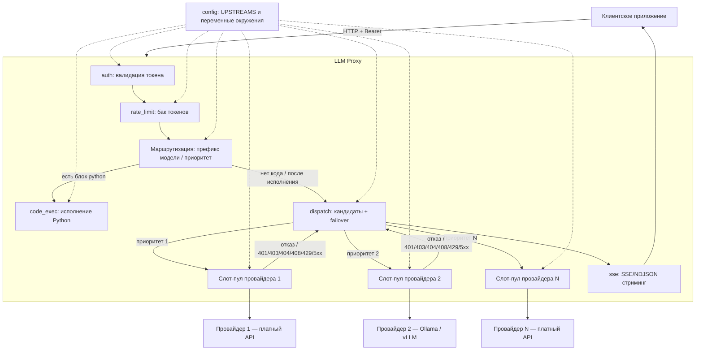

# Комплект проектной документации «LLM Proxy»
.

## 1. Техническое задание (ГОСТ 19.201)

### 1.1 Наименование и область применения

Программное изделие «LLM Proxy» (далее — Прокси) представляет собой прокси-шлюз для безопасного доступа к API больших языковых моделей (LLM) с поддержкой **нескольких внешних провайдеров (апстримов) с приоритетами и автоматическим переключением при отказе (failover)** и функцией исполнения Python-кода в изолированной среде. Прокси предназначен для развёртывания в контуре доверенной инфраструктуры и обеспечивает единую точку входа для клиентских приложений, обращающихся к внешним LLM-провайдерам (апстримам): платным коммерческим API (OpenAI, OpenRouter, Timeweb Cloud, cloud.ru Foundation Models и др.) и бесплатным локальным (Ollama, vLLM).

Область применения:

- **работа с несколькими LLM-провайдерами по приоритетному списку с автоматическим failover при отказе любого из них**;
- маршрутизация запросов к конкретному провайдеру по префиксу модели (`ollama/llama3`, `timeweb/gpt-4o`);
- централизованное управление доступом к LLM API через Bearer-токены;
- ограничение частоты запросов (rate limiting) по алгоритму бака токенов;
- контроль конкурентности соединений с **независимым пулом слотов на каждого провайдера**;
- исполнение Python-кода, переданного в теле запроса, в изолированном подпроцессе с жёсткими временными и ресурсными ограничениями;
- стриминг ответов через Server-Sent Events (SSE) и NDJSON (Ollama) с механизмом обратного давления;
- сокрытие внутренних деталей ошибок апстримов и их ключей от клиентов.

### 1.2 Требования к функциональным характеристикам

| Характеристика          | Требование                                                                                                   |
| ----------------------- | ------------------------------------------------------------------------------------------------------------ |
| Язык реализации         | Rust 1.85+                                                                                                   |
| Асинхронный рантайм     | Tokio                                                                                                        |
| HTTP-сервер             | Axum                                                                                                         |
| HTTP-клиент             | reqwest с бэкендом rustls (TLS без OpenSSL)                                                                  |
| Сериализация            | serde\_json                                                                                                  |
| Провайдеры              | Список `UPSTREAMS`: `имя\|base_url[\|api_key][\|ollama], ...`; порядок записей = приоритет                    |
| Failover                | Повтор запроса у следующего провайдера при ошибке сети/таймауте, HTTP 401/403/404/408/429/5xx                 |
| Маршрутизация           | Модель с префиксом `имя/` — заданному провайдеру (без failover); без префикса — первому живому по приоритету  |
| Обратная совместимость  | `UPSTREAM_API_KEY` + `UPSTREAM_BASE_URL` (провайдер `primary`) + автоматическая Ollama                        |
| Аутентификация          | Bearer-токены, сравнение в постоянном времени (subtle::ConstantTimeEq)                                       |
| Rate Limiting           | Алгоритм бака токенов: емкость = RPM, пополнение = RPM/60 токенов/сек                                        |
| Конкурентность          | Семафор **на каждого провайдера** (try\_acquire), при перегрузке — HTTP 503; для Ollama — `MAX_CONCURRENT/2`   |
| Исполнение кода         | Поиск блоков с маркером ограждения `python`, запуск через `PYTHON_BIN -c`, таймаут 30 с, `kill_on_drop=true` |
| SSE/NDJSON стриминг     | mpsc-канал ёмкостью 8, механизм обратного давления при заполнении                                            |
| Лимит входящего запроса | 1 MiB                                                                                                        |
| Лимит исходящего ответа | 16 MiB                                                                                                       |
| Безопасность сети       | Запрет редиректов, валидация Base URL, http к не-loopback апстримам — только при `ALLOW_HTTP_UPSTREAM=1`      |
| Безопасность ключей     | Ключ каждого провайдера подставляется только при отправке; не логируется и не возвращается клиенту           |
| Fail-fast конфигурация  | Прокси не запускается при некорректных `UPSTREAMS`, дубликатах имён, ключах короче 16 символов               |

### 1.3 Требования к надежности и безопасности

- Все секреты (ключи API провайдеров и клиентские ключи) передаются исключительно через переменные окружения; хранение в коде или конфигурационных файлах не допускается.
- Сравнение клиентских токенов выполняется в постоянном времени для предотвращения атак по побочным каналам.
- Ключ каждого провайдера (`api_key` записи `UPSTREAMS`) никогда не логируется и не возвращается клиенту; подставляется в запрос только в момент отправки соответствующему провайдеру.
- **Отказ одного провайдера не приводит к отказу сервиса**: запрос автоматически повторяется у следующего по приоритету провайдера (failover). Отказ всех провайдеров даёт клиенту обобщённый ответ `502` с числом попыток.
- Повторный запрос выполняется **только при ошибках, указывающих на недоступность провайдера** (ошибка соединения, таймаут, 401/403/404/408/429, 5xx). Прочие клиентские ошибки 4xx (400, 413, 422) возвращаются клиенту как есть, без повторов.
- Failover не выполняется после начала передачи стрима клиенту (частичный ответ нельзя продолжить у другого провайдера без дублирования).
- Исполнение Python-кода изолировано: процесс запускается с `kill_on_drop=true`, что гарантирует завершение дочернего процесса при аварийном завершении родительского.
- Редиректы на уровне HTTP-клиента запрещены (`redirect::Policy::none()`), исключая SSRF-вектора; Base URL каждого провайдера валидируется при старте (fail-fast).
- Ошибки аутентификации и авторизации апстримов (401, 403) не передаются клиенту с деталями конкретного провайдера: при исчерпании списка кандидатов возвращается обобщённый `502`.

### 1.4 Порядок приемки

Приёмка работы производится по результатам исполнения программы и методики испытаний (раздел 5). Критерии приемки:

- все тестовые сценарии завершаются со статусом «пройден», включая сценарии failover (раздел 5.2.5);
- отсутствуют критические и высокие уязвимости по результатам статического анализа (cargo audit, clippy -D warnings);
- нагрузочное тестирование подтверждает устойчивость к заданному RPM при заданном `MAX_CONCURRENT`;
- документация комплекта соответствует требованиям ЕСПД ГОСТ 19.xxx.

---

## 2. Спецификация (ГОСТ 19.202)

### 2.1 Состав программы

Программа «LLM Proxy» поставляется как единственный исполняемый файл `llm-proxy` (статически линкованный, где возможно) и состоит из следующих логических модулей:

| Модуль        | Назначение                                                                                          |
| ------------- | --------------------------------------------------------------------------------------------------- |
| `main`        | Точка входа, инициализация конфигурации, логирование списка провайдеров, запуск HTTP-сервера, graceful shutdown |
| `auth`        | Валидация Bearer-токенов, constant-time сравнение                                                   |
| `rate_limit`  | Реализация алгоритма бака токенов на уровне IP/токена                                               |
| `concurrency` | Семофоры ограничения одновременных запросов — **отдельный пул на каждого провайдера**               |
| `code_exec`   | Поиск блоков кода, запуск Python-подпроцесса, сбор stdout/stderr                                    |
| `sse`         | Формирование SSE/NDJSON-потока, mpsc-канал с backpressure                                           |
| `providers`   | Модель провайдера: разбор `UPSTREAMS`, тип (openai/ollama), ключ, валидация URL                     |
| `dispatch`    | Диспетчер запросов: построение списка кандидатов по префиксу/приоритету, failover, подстановка ключей |
| `upstream`    | HTTP-клиент к апстримам, запрет редиректов, таймауты, маппинг ошибок                                 |
| `config`      | Чтение и валидация переменных окружения (`UPSTREAMS` и legacy-переменные)                           |

### 2.2 Состав документации

Комплект проектной документации включает следующие документы (в соответствии с ЕСПД ГОСТ 19.xxx):

| Обозначение | Наименование документа              | ГОСТ   |
| ----------- | ----------------------------------- | ------ |
| ТЗ          | Техническое задание                 | 19.201 |
| СП          | Спецификация                        | 19.202 |
| ОП          | Описание программы                  | 19.402 |
| ПЗ          | Пояснительная записка               | 19.404 |
| ПМИ         | Программа и методика испытаний      | 19.301 |
| РСП         | Руководство системного программиста | 19.503 |
| РО          | Руководство оператора               | 19.505 |
| Ф           | Формуляр                            | 19.501 |
| ОПР         | Описание применения                 | 19.502 |
| ВДП         | Ведомость держателей подлинников    | 19.403 |
| Т           | Тезаурус и расшифровка аббревиатур  | —      |

---

## 3. Описание программы (ГОСТ 19.402)

### 3.1 Логическая структура

Логическая структура программы представлена на диаграмме компонентов (Mermaid):



> **Примечание.** Стрелки обозначают поток управления и данных. Пунктирные линии — внедрение конфигурации. Каждый провайдер имеет собственный пул слотов конкурентности и собственный ключ авторизации.

### 3.2 Алгоритм маршрутизации и failover

1. Входящий запрос проходит этапы аутентификации, rate limiting и парсинга JSON.
2. Выполняется санитизация запроса и исполнение Python-блоков (см. 3.3).
3. Формируется список провайдеров-кандидатов:
   - если модель указана с префиксом `имя/` (например, `ollama/llama3`), кандидат — **только** заданный провайдер; префикс срезается перед отправкой;
   - если модель без префикса, кандидаты — все провайдеры в порядке приоритета из `UPSTREAMS`.
4. Для каждого кандидата последовательно:
   - захватывается слот его собственного семафора (при исчерпании всех слотов — `503 Busy` без обращений к провайдерам);
   - выполняется запрос к провайдеру с подстановкой **его** ключа авторизации;
   - при ошибке соединения, таймауте или ответе 401/403/404/408/429/5xx слот освобождается и запрос повторяется у следующего кандидата;
   - при прочих ошибках 4xx (400, 413, 422 — ошибка в самом запросе) ответ возвращается клиенту как есть, без повторов;
   - после начала передачи стрима клиенту failover не выполняется.
5. Если ни один кандидат не ответил, клиент получает `502` с числом выполненных попыток.
6. Успешный ответ стримится клиенту через SSE (OpenAI-совместимые провайдеры) или NDJSON (Ollama, native-эндпоинты `/api/*`).
7. Для провайдеров типа `ollama` дополнительно проксируются native-эндпоинты `POST /api/chat`, `POST /api/generate`, `POST /api/embeddings`, `POST /api/show`, `GET /api/tags`, `GET /api/version` на первого провайдера этого типа; allowlist моделей для `/api/*` принимает и «голое» имя, и имя с префиксом.

### 3.3 Алгоритм исполнения кода

1. Тело запроса парсится как JSON. Поиск блоков кода выполняется по регулярному выражению для маркеров ограждения `` ```python ... ``` `` (в `content` сообщений и в `prompt` для `/api/generate`).
2. Для каждого найденного блока:
   - формируется строка кода;
   - запускается подпроцесс `PYTHON_BIN -c "<code>"` с таймаутом 30 секунд;
   - флаг `kill_on_drop=true` гарантирует завершение процесса при панике или отмене задачи;
   - stdout/stderr захватываются, объединяются и подставляются в сообщение.
3. Если блоков кода нет, запрос передаётся диспетчеру без изменений.
4. Результат отправляется провайдеру по правилам раздела 3.2.

### 3.4 Используемые методы (с русскими терминами)

| Английский термин        | Русский термин                 | Применение в программе                            |
| ------------------------ | ------------------------------ | ------------------------------------------------- |
| Token Bucket             | алгоритм бака токенов          | Rate limiting входящих запросов                   |
| backpressure             | механизм обратного давления    | SSE/NDJSON mpsc-канал ёмкостью 8                  |
| upstream                 | апстрим / внешний провайдер    | HTTP-клиент к LLM API                             |
| failover                 | переключение при отказе        | Повтор запроса у следующего провайдера по приоритету |
| provider priority        | приоритет провайдера           | Порядок записей в `UPSTREAMS`                     |
| model prefix routing     | маршрутизация по префиксу модели | `ollama/llama3` → провайдеру `ollama`           |
| clamp                    | ограничение сверху             | Лимиты тела запроса (1 MiB) и ответа (16 MiB)     |
| fence                    | маркер ограждения (fence)      | Поиск блоков `` ```python ... ``` ``              |
| constant-time comparison | сравнение в постоянном времени | Валидация Bearer-токенов (subtle::ConstantTimeEq) |
| kill on drop             | завершение при уничтожении     | Гарантированная остановка Python-подпроцесса      |
| redirect policy          | политика редиректов            | Запрет редиректов (Policy::none)                  |

---

## 4. Пояснительная записка (ГОСТ 19.404)

### 4.1 Обоснование выбора технологий

**Rust 1.85+** выбран за сочетание безопасности памяти без сборщика мусора, высокой производительности и зрелой экосистемы асинхронного программирования. Отсутствие runtime-оверхеда критично для прокси-шлюза с жёсткими требованиями к латентности, включая цепочки failover-попыток.

**Tokio** — де-факто стандарт асинхронного рантайма в Rust, обеспечивает эффективную работу с тысячами одновременных соединений при минимальном потреблении памяти.

**Axum** — типобезопасный, модульный веб-фреймворк, построенный на `tower::Service`, что позволяет комбинировать middleware (аутентификация, rate limiting, лимиты тела) декларативно.

**reqwest с rustls** — исключает зависимость от OpenSSL, уменьшает поверхность атаки и упрощает поставку (статическая линковка TLS). Клиент создаётся отдельно для каждого провайдера, что даёт независимые таймауты и гарантирует отсутствие утечки ключа одного провайдера другому.

**serde\_json** — стандарт де-факто для JSON в Rust, нулевая стоимость абстракции при де/сериализации.

**subtle** — предоставляет константное время сравнения (`ConstantTimeEq`), необходимое для защиты от атак по времени при проверке токенов.

**regex** — компилируемые регулярные выражения для поиска маркеров ограждения кода; безопасны по отношению к ReDoS за счет ограниченной сложности паттерна.

### 4.2 Архитектурные решения

1. **Stateless дизайн**. Прокси не хранит состояние между запросами (кроме in-memory rate limit buckets). Это позволяет горизонтально масштабировать экземпляры за балансировщиком без сессионной привязки.

2. **Middleware-цепочка**. Аутентификация → rate limiting → маршрутизация реализованы как слои `tower::Layer`. Порядок важен: аутентификация первой, чтобы не тратить квоты и failover-попытки на неавторизованные запросы.

3. **Список провайдеров как единый механизм**. Все апстримы — OpenAI-совместимые коммерческие API, локальный vLLM и Ollama — описываются записями одного списка `UPSTREAMS`. Разнообразие сведено к типу провайдера (`openai` / `ollama`): это устранило отдельные пути обработки Ollama из горячего кода маршрутизации и позволило применять failover равноправно ко всем провайдерам. Провайдеры типа `ollama` лишь дополнительно получают native-эндпоинты `/api/*` и NDJSON-стриминг.

4. **Failover-диспетчер**. Список кандидатов строится один раз (префикс модели или порядок приоритета), попытки выполняются последовательно с собственными ключами и таймаутами. Повтор разрешён только для ошибок «провайдер недоступен» (сеть, таймаут, 401/403/404/408/429/5xx); клиентские ошибки 4xx возвращаются сразу. Это исключает бесполезные повторные платные запросы при ошибках самого клиента.

5. **Изоляция исполнения кода**. Python запускается как отдельный процесс (не встроенный интерпретатор), что даёт сильную изоляцию за счёт ОС. Таймаут 30 с и `kill_on_drop` предотвращают зависания и утечки ресурсов.

6. **SSE/NDJSON с backpressure**. mpsc-канал ёмкостью 8 служит буфером между задачей чтения апстрима и задачей записи клиенту. При заполнении канала задача чтения блокируется (`send().await`), создавая естественное обратное давление на провайдера. Слот конкурентности провайдера удерживается до конца стрима.

7. **Сокрытие ошибок апстримов**. Детали ответов провайдеров и их ключи не раскрываются клиенту; при исчерпании кандидатов возвращается обобщённый `502`. Клиент не может определить, какой именно провайдер из списка обслужил или отклонил запрос.

8. **Независимые пулы конкурентности**. Семофор создаётся на каждого провайдера (`MAX_CONCURRENT` для обычных, `MAX_CONCURRENT/2` для Ollama). Тяжёлые локальные модели не выедают слоты платного API и наоборот.

9. **Конфигурация только через окружение**. Соответствует методологии Twelve-Factor App, упрощает развёртывание в контейнерах и CI/CD, исключает утечку секретов в репозиторий. Конфигурация проверяется fail-fast: прокси не запустится с некорректным списком `UPSTREAMS`, дубликатами имён провайдеров, ключами короче 16 символов или URL без `/v1` у OpenAI-совместимых провайдеров.

10. **Обратная совместимость**. Переменные `UPSTREAM_API_KEY` + `UPSTREAM_BASE_URL` создают провайдера `primary`, а Ollama автоматически добавляется запасным провайдером на `http://127.0.0.1:11434` (настраивается `OLLAMA_*`). Это позволяет обновить бинарник без изменения окружения и мигрировать на `UPSTREAMS` постепенно.

### 4.3 Обоснование отказа от устаревших зависимостей и решений

- **OpenSSL** → заменён на **rustls** (чистый Rust TLS). Устраняет класс уязвимостей C-библиотеки, упрощает аудит, позволяет полную статическую линковку.
- **Единственный апстрим** (`UPSTREAM_BASE_URL` + `UPSTREAM_API_KEY`) → заменён на **список провайдеров** `UPSTREAMS`. Единственная точка отказа превращена в приоритетную цепочку с автоматическим failover; разделение «бесплатный локальный провайдер → платные API» даёт экономию средств и устойчивость к квотам.
- **Отдельная логика Ollama** (`OLLAMA_ENABLED`, `OLLAMA_BASE_URL`, `OLLAMA_MODEL_PREFIX`) → Ollama описывается обычной записью `UPSTREAMS` (пустой ключ = запрос без Authorization). Legacy-переменные сохранены для развёртываний, уже их использующих.
- **Синхронные блокирующие вызовы** → полностью исключены из горячего пути. Исполнение Python-кода выполняется в `tokio::task::spawn_blocking`, не блокируя рантайм.
- **Динамическая линковка системных библиотек** → по возможности статическая сборка (`musl` target) для переносимости и воспроизводимости.
- **Устаревшие паттерны rate limiting** (fixed window, leaky bucket) → алгоритм бака токенов даёт более гладкое ограничение и лучшую утилизацию квоты при бурст-нагрузке.

---

## 5. Программа и методика испытаний (ГОСТ 19.301)

### 5.1 Объект испытаний

Объектом испытаний является исполняемый файл `llm-proxy` версии, соответствующей спецификации (раздел 2), развёрнутый в тестовой среде с заданными переменными окружения.

Тестовая среда:

- ОС: Linux (x86\_64), glibc 2.35+ или musl 1.2+
- Python: CPython 3.11+ (путь задаётся через `PYTHON_BIN`)
- Апстримы: **два и более** мок-серверов, эмулирующих OpenAI-совместимый API (SSE и non-streaming) и native-API Ollama (`/api/*`, NDJSON); моки управляются тестами (`tests/failover.rs`) и позволяют задавать коды ответов и отказы соединений.

### 5.2 Тестовые сценарии

#### 5.2.1 Сценарии аутентификации

| ID      | Название                   | Входные данные                      | Ожидаемый результат                                |
| ------- | -------------------------- | ----------------------------------- | -------------------------------------------------- |
| AUTH-01 | Валидный токен в заголовке | `Authorization: Bearer <valid_key>` | HTTP 200, запрос обработан                         |
| AUTH-02 | Невалидный токен           | `Authorization: Bearer invalid`     | HTTP 401, тело `{"error":"unauthorized"}`          |
| AUTH-03 | Отсутствующий заголовок    | Нет заголовка Authorization         | HTTP 401                                           |
| AUTH-04 | Constant-time проверка     | Тайминг атака (замеры нс)           | Разброс времени &lt; 1 мкс для валидных/невалидных |
| AUTH-05 | Ключ короче 16 символов    | `PROXY_API_KEYS="short"`            | Прокси не запускается (fail-fast), ошибка в stderr |

#### 5.2.2 Сценарии маршрутизации и failover

| ID         | Название                          | Входные данные                                                        | Ожидаемый результат                                                    |
| ---------- | --------------------------------- | --------------------------------------------------------------------- | ---------------------------------------------------------------------- |
| FOF-01     | Отказ первого провайдера (5xx)    | `UPSTREAMS` из двух провайдеров; первый отвечает 500                   | Успешный ответ от второго провайдера, статус 200                       |
| FOF-02     | Отказ первого (соединение)        | Первый провайдер недоступен (порт закрыт)                             | Запрос обслужен вторым провайдером                                     |
| FOF-03     | 401 у первого провайдера          | Первый отвечает `401 Invalid API key`                                 | Failover к следующему; ключ второго подставлен корректно               |
| FOF-04     | 404 у первого (нет модели)        | Первый отвечает 404 на модель                                         | Failover к следующему                                                  |
| FOF-05     | 429 у первого (квота)             | Первый отвечает 429                                                   | Failover к следующему                                                  |
| FOF-06     | 400 у первого — без failover      | Первый отвечает 400 (ошибка клиента)                                  | Ответ 400 возвращён клиенту как есть, второй не вызывался              |
| FOF-07     | Все провайдеры недоступны         | Оба провайдера отвечают 5xx                                           | HTTP 502, в теле число попыток                                         |
| FOF-08     | Префикс направляет заданному      | Модель `p2/gpt-4o` при двух провайдерах                               | Запрос ушёл только провайдеру `p2`, префикс срезан, failover нет       |
| FOF-09     | Неизвестный префикс               | Модель `nosuch/model`                                                 | Ошибка 4xx без обращений к провайдерам                                 |
| FOF-10     | Изоляция ключей                   | Два провайдера с разными ключами                                      | Каждому провайдеру передан только его ключ (проверка на моках)         |
| FOF-11     | Изоляция пулов конкурентности     | `MAX_CONCURRENT=2`; длительный запрос к провайдеру 2                  | Запросы к провайдеру 1 обрабатываются, 503 не возникает                |
| FOF-12     | Некорректный `UPSTREAMS`          | Дубликат имени / URL без `/v1` / http к внешнему хосту                | Прокси не запускается, причина в сообщении об ошибке                   |
| FOF-13     | Обратная совместимость            | Только `UPSTREAM_API_KEY` + `UPSTREAM_BASE_URL`, без `UPSTREAMS`      | Провайдер `primary` + авт. Ollama `127.0.0.1:11434`, запросы работают  |
| FOF-14     | Failover native `/api/*`          | Провайдер типа ollama недоступен, второй тип ollama отвечает          | `POST /api/chat` обслужен вторым ollama-провайдером                    |

#### 5.2.3 Сценарии исполнения кода

| ID      | Название            | Входные данные                         | Ожидаемый результат                                   |
| ------- | ------------------- | -------------------------------------- | ----------------------------------------------------- |
| EXEC-01 | Простой print       | Блок `` ```python print(42) ``         | В ответе провайдера подставлено `42\n`                |
| EXEC-02 | Множественные блоки | Два блока python в одном запросе       | Оба исполнены, результаты подставлены последовательно |
| EXEC-03 | Таймаут             | `time.sleep(60)`                       | Процесс убит через 30 с, ошибка исполнения в ответе   |
| EXEC-04 | Ошибка синтаксиса   | `print(`                               | stderr захвачен, возвращён traceback                  |
| EXEC-05 | Kill on drop        | Отмена запроса клиентом во время sleep | Подпроцесс завершён, нет зомби-процессов              |
| EXEC-06 | Отсутствие кода     | Запрос без маркеров ограждения         | Запрос передан провайдеру без изменений               |

#### 5.2.4 Сценарии безопасности

| ID     | Название               | Входные данные                                                       | Ожидаемый результат                    |
| ------ | ---------------------- | -------------------------------------------------------------------- | -------------------------------------- |
| SEC-01 | Редирект апстрима      | Апстрим возвращает 302 Location: http://internal                     | HTTP 502, редирект не выполнен         |
| SEC-02 | Сокрытие 401 апстрима  | Апстрим возвращает 401 Invalid API key                               | Обобщённый ответ без деталей провайдера |
| SEC-03 | Сокрытие 403 апстрима  | Апстрим возвращает 403 Model not allowed                             | Обобщённый ответ без деталей провайдера |
| SEC-04 | Лимит тела запроса     | POST 2 MiB                                                           | HTTP 413 Payload Too Large             |
| SEC-05 | Лимит тела ответа      | Апстрим возвращает 20 MiB                                            | Соединение разорвано / HTTP 502        |
| SEC-06 | http к внешнему хосту  | `UPSTREAMS` с `http://` к не-loopback адресу без `ALLOW_HTTP_UPSTREAM` | Прокси не запускается (fail-fast)    |

#### 5.2.5 Сценарии backpressure, конкурентности и стриминга

| ID    | Название                   | Входные данные                             | Ожидаемый результат                                  |
| ----- | -------------------------- | ------------------------------------------ | ---------------------------------------------------- |
| BP-01 | Медленный клиент           | Клиент не читает SSE, канал заполняется    | Задача чтения апстрима блокируется, память не растёт |
| BP-02 | Превышение MAX\_CONCURRENT | `MAX_CONCURRENT=2`, 3 параллельных запроса к одному провайдеру | Третий получает HTTP 503          |
| BP-03 | Rate limit исчерпан        | RPM=10, 15 запросов за секунду             | 11-й и далее — HTTP 429                              |
| BP-04 | Восстановление бака        | Пауза 60 с после исчерпания                | Бак восстановлен, запросы проходят                   |
| BP-05 | NDJSON-стрим Ollama        | `POST /api/chat`, `"stream":true`          | Поток chunks передан клиенту, слот освобождён в конце |
| BP-06 | Слот удерживается стримом  | Длинный SSE-стрим                          | Слот провайдера занят до конца стрима                |

#### 5.2.6 Нагрузочное тестирование

- Инструмент: `wrk` или `oha`
- Профиль: 1000 RPS, 60 с, `MAX_CONCURRENT=500`, `RATE_LIMIT_PER_MIN=60000`, один провайдер-мок
- Критерии: p99 латентность &lt; 200 мс (без исполнения кода), 0 ошибок 5xx, утилизация CPU &lt; 80%, RSS &lt; 200 MiB; при отключении мока — корректный failover без утечки соединений и слотов.

### 5.3 Состав автоматизированных тестов

| Набор               | Состав                                                          |
| ------------------- | --------------------------------------------------------------- |
| Юнит-тесты (37)     | Разбор `UPSTREAMS`, валидация URL, аутентификация, rate limiter, маршрутизация по префиксам, clamp токенов, allowlist, failover-статусы |
| Интеграционные (5)  | `tests/failover.rs`: живые мок-серверы + настоящий прокси — 500 у первого → успех у второго; недоступный провайдер пропускается; 4xx без failover; префикс выбирает заданного провайдера; все недоступны → 502 |

---

## 6. Эксплуатационные документы

### 6.1 Руководство системного программиста (ГОСТ 19.503)

#### 6.1.1 Требования к среде

- Linux kernel 5.10+ (поддержка `pidfd` для надёжного `kill_on_drop`)
- Python 3.11+ в PATH или по абсолютному пути (`PYTHON_BIN`)
- 64-битная архитектура (x86\_64 или aarch64)
- Минимум 128 MiB RAM под процесс прокси + запас под Python-подпроцессы
- Сетевая доступность всех провайдеров из `UPSTREAMS` (при недоступности части из них сервис продолжает работать, но запросы к недоступным будут замедлены на connect-таймаут)

#### 6.1.2 Установка и развёртывание

1. Получить бинарный файл `llm-proxy` (сборка: `cargo build --release --target x86_64-unknown-linux-musl`).
2. Разместить в `/usr/local/bin/` или другом каталоге; рядом — `start.sh` (см. раздел 6.1.4).
3. Создать systemd-юнит (пример):

```ini
[Unit]
Description=LLM Proxy
After=network.target

[Service]
Type=simple
ExecStart=/usr/local/bin/start.sh
EnvironmentFile=/etc/llm-proxy/env
Restart=on-failure
RestartSec=5
LimitNOFILE=65535
MemoryMax=512M
CPUQuota=200%

[Install]
WantedBy=multi-user.target
```

4. Создать `/etc/llm-proxy/env` с переменными окружения (см. раздел 6.1.3). Рекомендуемая конфигурация — бесплатный провайдер первым, платные далее:

```bash
export PROXY_API_KEYS="client-key-aaaaaaaaaaaaaaaa,client-key-bbbbbbbbbbbbbbbb"
export UPSTREAMS="ollama|http://172.16.162.33:11434|, \
  timeweb|https://api.timeweb.ai/v1|sk-..., \
  openrouter|https://openrouter.ai/api/v1|sk-or-v1-..., \
  cloudru|https://foundation-models.api.cloud.ru/v1|token"
export ALLOW_HTTP_UPSTREAM=1
export PROXY_LISTEN="127.0.0.1:8080"
```

5. `systemctl daemon-reload && systemctl enable --now llm-proxy`.

#### 6.1.3 Переменные окружения

| Переменная           | Обязательна | Описание                                                                     | Пример / по умолчанию                    |
| -------------------- | ----------- | ---------------------------------------------------------------------------- | ---------------------------------------- |
| `PROXY_API_KEYS`     | Да          | Клиентские Bearer-токены через запятую, ≥ 16 символов каждый                 | `client-key-1,client-key-2`              |
| `UPSTREAMS`          | Да\*        | Провайдеры по приоритету: `имя\|base_url[\|ключ][\|ollama], ...`              | `ollama\|http://127.0.0.1:11434\|, ...`  |
| `UPSTREAM_API_KEY`   | Да\*        | Ключ провайдера (устаревший способ; создаёт провайдера `primary`)            | `sk-upstream-xyz`                        |
| `UPSTREAM_BASE_URL`  | Нет         | Base URL провайдера (устаревший способ)                                      | `https://api.openai.com/v1`              |
| `PROXY_LISTEN`       | Нет         | Адрес прослушивания                                                          | `127.0.0.1:8080`                         |
| `ALLOWED_MODELS`     | Нет         | Allowlist моделей через запятую (с префиксами); пусто = все (опасно)         | `gpt-4o-mini,ollama/llama3`              |
| `MAX_OUTPUT_TOKENS`  | Нет         | Потолок `max_tokens`/`max_completion_tokens`/`num_predict`                   | `4096`                                   |
| `MAX_CONCURRENT`     | Нет         | Слоты конкурентности на провайдера (для ollama — вдвое меньше)               | `32`                                     |
| `RATE_LIMIT_PER_MIN` | Нет         | RPM для алгоритма бака токенов на клиента                                    | `60`                                     |
| `REQUEST_TIMEOUT_SECS` | Нет       | Таймаут нестриминговых запросов (1–600)                                      | `120`                                    |
| `UPSTREAM_IDLE_TIMEOUT_SECS` | Нет | Idle-таймаут стримов (1–600)                                                 | `120`                                    |
| `PYTHON_BIN`         | Нет         | Путь к интерпретатору Python; пусто = python-блоки не исполняются            | `/usr/bin/python3.11`                    |
| `ALLOW_HTTP_UPSTREAM`| Нет         | `1` — разрешить http:// к не-loopback провайдерам (напр., Ollama в LAN)      | `0`                                      |
| `OLLAMA_ENABLED`     | Нет         | `0` — выключить авто-Ollama (только legacy-способ)                           | `1`                                      |
| `OLLAMA_BASE_URL`    | Нет         | Корневой URL Ollama БЕЗ `/v1` (только legacy-способ)                         | `http://127.0.0.1:11434`                 |
| `OLLAMA_API_KEY`     | Нет         | Ключ, если Ollama за авторизацией (только legacy-способ)                     | —                                        |
| `OLLAMA_MODEL_PREFIX`| Нет         | Префикс маршрутизации (только legacy-способ)                                 | `ollama/`                                |
| `RUST_LOG`           | Нет         | Уровень логирования                                                          | `info`                                   |

\* Обязателен `UPSTREAMS` **или** пара `UPSTREAM_API_KEY` + `UPSTREAM_BASE_URL`; хотя бы один провайдер должен быть настроен.

> **Важно.** Все ключи должны быть высокоэнтропийными строками (минимум 32 символа base64url для провайдеров, ≥ 16 символов для клиентских). Ротация выполняется перезапуском сервиса с новым `EnvironmentFile`. Конфигурация проверяется fail-fast: некорректные записи (`UPSTREAMS`, URL, ключи короче 16 символов, дубликаты имён) приводят к отказу старта с пояснением причины.

#### 6.1.4 Файл запуска start.sh

Рекомендуется использовать поставляемый `start.sh`: он задаёт переменные окружения (включая `UPSTREAMS` с приоритетами) и запускает `./llm-proxy` через `exec` из собственного каталога. Типовая конфигурация — бесплатный провайдер (Ollama) первым, платные далее. Порядок записей в `UPSTREAMS` — единственное место, определяющее приоритеты; для направления запроса конкретному провайдеру в обход приоритета используется префикс модели (`timeweb/gpt-4o`).

#### 6.1.5 Мониторинг и логирование

- Логи: структурированный вывод в stdout (уровень `info` по умолчанию, `RUST_LOG` для настройки). При старте выводится список провайдеров с приоритетами и типами (ключи не выводятся). При failover логируется провайдер, на котором произошёл отказ, и код причины.
- Ключевые метрики (экспортируются через tracing-opentelemetry при сборке с фичей `metrics`):
  - `http_requests_total` (counter, labels: method, path, status)
  - `http_request_duration_seconds` (histogram)
  - `rate_limit_rejected_total` (counter)
  - `concurrency_rejected_total` (counter, label: provider)
  - `provider_failover_total` (counter, labels: provider, reason)
  - `provider_attempts` (histogram — число попыток до успеха)
  - `code_exec_duration_seconds` (histogram)
  - `upstream_errors_total` (counter, labels: provider, error\_type)

#### 6.1.6 Резервное копирование и восстановление

Прокси не имеет постоянного состояния. Резервное копирование не требуется. Восстановление — перезапуск бинарника с тем же `EnvironmentFile`.

#### 6.1.7 Обновление версии

1. Остановить сервис: `systemctl stop llm-proxy`.
2. Заменить бинарник на новую версию.
3. При необходимости мигрировать окружение на `UPSTREAMS` (legacy-переменные продолжают работать без изменений).
4. Запустить: `systemctl start llm-proxy`.
5. Проверить health-check: `curl -f http://127.0.0.1:8080/health` → `{"status":"ok"}` и список провайдеров в логе старта.

### 6.2 Руководство оператора (ГОСТ 19.505)

#### 6.2.1 Запуск и остановка

| Действие                   | Команда                             |
| -------------------------- | ------------------------------------ |
| Запуск                     | `systemctl start llm-proxy`          |
| Остановка                  | `systemctl stop llm-proxy`           |
| Перезапуск                 | `systemctl restart llm-proxy`        |
| Статус                     | `systemctl status llm-proxy`         |
| Логи (последние 100 строк) | `journalctl -u llm-proxy -n 100 -f`  |

#### 6.2.2 Проверка работоспособности

1. **Health-check**: `curl -s http://127.0.0.1:8080/health` → `{"status":"ok"}`.
2. **Тестовый запрос** (требует валидный `PROXY_API_KEYS`):

```bash
curl -X POST http://127.0.0.1:8080/v1/chat/completions \
  -H "Authorization: Bearer client-key-1" \
  -H "Content-Type: application/json" \
  -d '{"model":"gpt-4o-mini","messages":[{"role":"user","content":"Сколько будет 2+2?"}]}'
```

Ожидаемый ответ: JSON с полем `choices[0].message.content`. Запрос обслуживается первым живым провайдером по приоритету.

3. **Проверка failover** (опционально): временно остановить первого провайдера и убедиться, что запросы продолжают обслуживаться вторым (в логе — запись о переключении).

#### 6.2.3 Типовые инциденты и действия

| Симптом                                | Причина                                                        | Действие оператора                                                                  |
| -------------------------------------- | -------------------------------------------------------------- | ------------------------------------------------------------------------------------ |
| HTTP 503 на всех запросах              | Слоты всех провайдеров исчерпаны                               | Проверить нагрузку, при необходимости увеличить `MAX_CONCURRENT` и перезапустить      |
| HTTP 429 частые                        | `RATE_LIMIT_PER_MIN` слишком низкий                            | Увеличить значение, перезапустить                                                     |
| HTTP 502 на всех запросах              | Все провайдеры из `UPSTREAMS` недоступны                       | Проверить доступность и ключи всех провайдеров; см. логи (причина каждой попытки)     |
| Запросы медленные, но работают         | Первые провайдеры в списке недоступны: каждая попытка ждёт connect-таймаут | Восстановить/удалить недоступных провайдеров из начала `UPSTREAMS`; перезапустить |
| Ответы не от того провайдера           | Ожидание по приоритету или опечатка в префиксе модели          | Проверить порядок `UPSTREAMS`; использовать префикс модели (`timeweb/gpt-4o`)         |
| Ollama не отвечает                     | Не запущена или недоступен хост                                | Проверить `OLLAMA_BASE_URL`/запись в `UPSTREAMS`; сервис при этом продолжит работать через другие провайдеры |
| Python код не исполняется              | `PYTHON_BIN` неверен или Python отсутствует                    | Проверить путь, установить Python, перезапустить                                      |
| Прокси не запускается                  | Некорректный `UPSTREAMS` (URL, ключи, дубликаты имён)          | Исправить `EnvironmentFile` по тексту ошибки старта                                   |
| Память растёт неограниченно            | Утечка в коде / зависшие подпроцессы                           | Перезапустить сервис, сообщить разработчикам                                          |

#### 6.2.4 Обращение в техподдержку

При неразрешимых инцидентах собрать:

- `journalctl -u llm-proxy --since "1 hour ago" > logs.txt`
- `systemctl status llm-proxy`
- вывод `curl -v` к эндпоинту
- содержимое `UPSTREAMS` **без ключей** (имена и base_url провайдеров)
- версию бинарника (`llm-proxy --version` или `sha256sum`)

Передать разработчикам через установленный канал. Ключи провайдеров и клиентские ключи в обращение включать запрещено.

---

## 7. Формуляр (ГОСТ 19.501)

| Поле                  | Значение                                 |
| --------------------- | ---------------------------------------- |
| Наименование изделия  | LLM Proxy                                |
| Обозначение изделия   | ЛЛМ-ПРОКСИ                               |
| Вид документа         | Комплект проектной документации          |
| Регистрационный номер | ЛЛМ-ПРОКСИ.001 КД                        |
| Номер изменения       | 01 (добавлена мульти-провайдерность: `UPSTREAMS`, failover, префиксная маршрутизация, Ollama как провайдер) |
| Подпись разработчика  | \_\_\_\_\_\_\_\_\_\_\_\_\_ /Иванов И.И./ |
| Дата                  | 2026-11-21                               |
| Утверждаю             | \_\_\_\_\_\_\_\_\_\_\_\_\_ /Петров П.П./ |
| Дата утверждения      | 2026-11-21                               |

---

## 8. Описание применения (ГОСТ 19.502)

### 8.1 Назначение и условия применения

Программа «LLM Proxy» применяется в информационных системах, требующих контролируемого доступа к одному или нескольким внешним LLM API с возможностью серверного исполнения Python-кода. Типовые сценарии:

- корпоративный шлюз для доступа сотрудников к LLM с аудитом и квотированием;
- **экономия бюджета: бесплатный локальный провайдер (Ollama) в качестве первого приоритета, платные API — как резерв и для моделей, отсутствующих локально**;
- **повышение отказоустойчивости: автоматическое переключение между коммерческими провайдерами при авариях, исчерпании квот (429) и протухании ключей (401/403)**;
- бэкенд для чат-ботов, требующих вычислений (графики, анализ данных) через Python;
- изоляция недоверенного кода, генерируемого LLM, перед исполнением.

### 8.2 Состав параметров эксплуатации

| Параметр                                | Значение                   |
| --------------------------------------- | -------------------------- |
| Макс. RPS (при настройках по умолчанию) | \~1000                     |
| Латентность p99 (без исполнения кода)   | &lt; 50 мс                 |
| Латентность исполнения Python (p99)     | &lt; 5 с (зависит от кода) |
| Штраф латентности при недоступном первом провайдере | до connect-таймаута (10 с) на каждого недоступного кандидата |
| Потребление памяти (базовое)            | \~30 MiB                   |
| Потребление памяти (под нагрузкой)      | до 200 MiB                 |
| Дисковое пространство                   | &lt; 50 MiB (бинарник)     |

### 8.3 Интерфейсы взаимодействия

- **Входной**: HTTP/1.1 + JSON (REST), SSE для стриминга, NDJSON для native-эндпоинтов Ollama. Порт по умолчанию 8080 (настраивается `PROXY_LISTEN`).
- **Выходной (провайдеры)**: HTTPS (TLS 1.2/1.3 через rustls) к OpenAI-совместимым API; допускается http:// к loopback, а к не-loopback хостам — только при `ALLOW_HTTP_UPSTREAM=1`. Число провайдеров — по списку `UPSTREAMS`, ключ каждого — свой.
- **Управление**: переменные окружения (`UPSTREAMS`, `PROXY_API_KEYS` и др.), systemd, файл `start.sh`.

### 8.4 Ограничения применения

- Не предназначен для прямого доступа из интернета без дополнительного WAF/балансировщика.
- Исполнение Python-кода — доверенная граница: код выполняется с правами пользователя сервиса. Для высокой изоляции рекомендуется запуск в контейнере с `gVisor`/`Kata Containers` или отдельной VM.
- Не поддерживает gRPC, WebSocket, GraphQL — только HTTP/JSON + SSE/NDJSON.
- Rate limiting глобален на экземпляр; при горизонтальном масштабировании требуется внешний координирующий rate limiter (Redis + Lua) для точного глобального лимита.
- **Failover не ретраит внутри одного провайдера**: для устойчивости к «мигающему» сервису заведите две записи одного провайдера с разными именами.
- **Failover не выполняется после начала стрима**: оборванный стрим клиенту не продолжается у другого провайдера.
- **Модели, уникальные для конкретного провайдера, рекомендуется указывать с префиксом** (`timeweb/gpt-4o`): иначе запрос сначала проверит бесплатного провайдера и получит быстрый 404, что добавляет небольшой штраф латентности.

---

## 9. Ведомость держателей подлинников (ГОСТ 19.403)

| №   | Документ                            | Обозначение        | Держатель подлинника               | Место хранения                | Срок хранения |
| --- | ----------------------------------- | ------------------ | ---------------------------------- | ----------------------------- | ------------- |
| 1   | Техническое задание                 | ЛЛМ-ПРОКСИ.001 ТЗ  | Отдел разработки                   | Git (main branch), GenOffice | Постоянно     |
| 2   | Спецификация                        | ЛЛМ-ПРОКСИ.001 СП  | Отдел разработки                   | Git, GenOffice               | Постоянно     |
| 3   | Описание программы                  | ЛЛМ-ПРОКСИ.001 ОП  | Отдел разработки                   | Git, GenOffice               | Постоянно     |
| 4   | Пояснительная записка               | ЛЛМ-ПРОКСИ.001 ПЗ  | Архитектор ПО                      | Git, GenOffice               | Постоянно     |
| 5   | Программа и методика испытаний      | ЛЛМ-ПРОКСИ.001 ПМИ | Отдел тестирования                 | Git, CI                      | Постоянно     |
| 6   | Руководство системного программиста | ЛЛМ-ПРОКСИ.001 РСП | DevOps / Админы                    | Git, Wiki                    | Постоянно     |
| 7   | Руководство оператора               | ЛЛМ-ПРОКСИ.001 РО  | Служба эксплуатации                | Wiki, печатный экземпляр     | Постоянно     |
| 8   | Формуляр                            | ЛЛМ-ПРОКСИ.001 Ф   | Отдел конфигурационного управления | Архив КД                     | Постоянно     |
| 9   | Описание применения                 | ЛЛМ-ПРОКСИ.001 ОПР | Архитектор ПО                      | Git, GenOffice               | Постоянно     |
| 10  | Ведомость держателей подлинников    | ЛЛМ-ПРОКСИ.001 ВДП | Отдел конфигурационного управления | Архив КД                     | Постоянно     |

> **Примечание.** Подлинники хранятся в системе контроля версий (Git) с защитой веток (branch protection) и обязательным code review. Печатные экземпляры (при необходимости) хранятся в архиве отдела конфигурационного управления в негорючих шкафах.

---

## 10. Тезаурус и расшифровка аббревиатур

| Аббревиатура / термин                                     | Расшифровка / определение                                                                 |
| --------------------------------------------------------- | ----------------------------------------------------------------------------------------- |
| LLM                                                       | Large Language Model — большая языковая модель                                            |
| API                                                       | Application Programming Interface — интерфейс программирования приложений                 |
| Proxy / Прокси                                            | Прокси-шлюз, промежуточный сервер                                                         |
| Upstream / Апстрим / Провайдер                            | Внешний провайдер LLM API (OpenAI, OpenRouter, Timeweb, cloud.ru, Ollama, vLLM и др.)     |
| UPSTREAMS                                                 | Переменная окружения со списком провайдеров по приоритету: `имя\|base_url[\|ключ][\|ollama]` |
| Provider priority / Приоритет провайдера                  | Позиция провайдера в списке `UPSTREAMS`; первая запись обрабатывает запрос первой          |
| Failover / Переключение при отказе                        | Автоматический повтор запроса у следующего провайдера при его недоступности или ошибке 401/403/404/408/429/5xx |
| Model prefix routing / Маршрутизация по префиксу модели   | Отправка запроса заданному провайдеру по префиксу имени модели (`ollama/llama3`, `timeweb/gpt-4o`) |
| NDJSON                                                    | Newline-Delimited JSON — стриминговый формат Ollama (объект JSON в каждой строке)          |
| Bearer-токен                                              | Токен доступа, передаваемый в заголовке `Authorization: Bearer <token>`                   |
| RPM                                                       | Requests Per Minute — запросов в минуту                                                   |
| Token Bucket / Алгоритм бака токенов                      | Алгоритм ограничения частоты: емкость = RPM, пополнение = RPM/60 токенов/сек              |
| Backpressure / Механизм обратного давления                | Механизм замедления производителя данных при переполнении буфера потребителя              |
| SSE                                                       | Server-Sent Events — технология серверной отправки событий (стриминг)                     |
| mpsc                                                      | Multi-producer, single-consumer — канал с множеством отправителей и одним получателем     |
| Fence / Маркер ограждения                                 | Синтаксическая конструкция `` ```python ... ``` `` для выделения блока кода               |
| Clamp / Ограничение сверху                                | Жёсткий верхний предел значения (размер тела запроса/ответа, выходные токены)             |
| Constant-time comparison / Сравнение в постоянном времени | Сравнение строк за фиксированное время, независимо от содержимого (защита от timing-атак) |
| Kill on drop / Завершение при уничтожении                 | Паттерн: деструктор гарантированно убивает дочерний процесс                               |
| Redirect policy / Политика редиректов                     | Правила обработки HTTP-редиректов клиентом (здесь: запрещены)                             |
| SSRF                                                      | Server-Side Request Forgery — подделка серверного запроса                                 |
| ReDoS                                                     | Regular Expression Denial of Service — DoS через регулярные выражения                     |
| Fail-fast конфигурация                                    | Проверка всех настроек при старте; некорректная конфигурация — отказ запуска              |
| Twelve-Factor App                                         | Методология построения SaaS-приложений (конфиг в окружении, stateless, и т.д.)            |
| musl                                                      | Легковесная libc для статической линковки                                                 |
| rustls                                                    | Реализация TLS на чистом Rust                                                             |
| Tokio                                                     | Асинхронный рантайм для Rust                                                              |
| Axum                                                      | Веб-фреймворк на базе tower::Service                                                      |
| reqwest                                                   | HTTP-клиент для Rust                                                                      |
| serde\_json                                               | Библиотека (де)сериализации JSON                                                          |
| subtle                                                    | Криптографические примитивы с constant-time гарантиями                                    |
| regex                                                     | Библиотека регулярных выражений                                                           |
| Ollama                                                    | Сервис локального запуска LLM; в Прокси — провайдер типа `ollama` с native-эндпоинтами `/api/*` |
| vLLM                                                      | Сервис локального OpenAI-совместимого инференса                                           |
| ГОСТ 19.xxx                                               | Единая система программной документации (ЕСПД), серия стандартов 19                       |
| ЕСПД                                                      | Единая система программной документации                                                   |
| КД                                                        | Комплект документации                                                                     |
| ТЗ                                                        | Техническое задание                                                                       |
| СП                                                        | Спецификация                                                                              |
| ОП                                                        | Описание программы                                                                        |
| ПЗ                                                        | Пояснительная записка                                                                     |
| ПМИ                                                       | Программа и методика испытаний                                                            |
| РСП                                                       | Руководство системного программиста                                                       |
| РО                                                        | Руководство оператора                                                                     |
| Ф                                                         | Формуляр                                                                                  |
| ОПР                                                       | Описание применения                                                                       |
| ВДП                                                       | Ведомость держателей подлинников                                                          |
