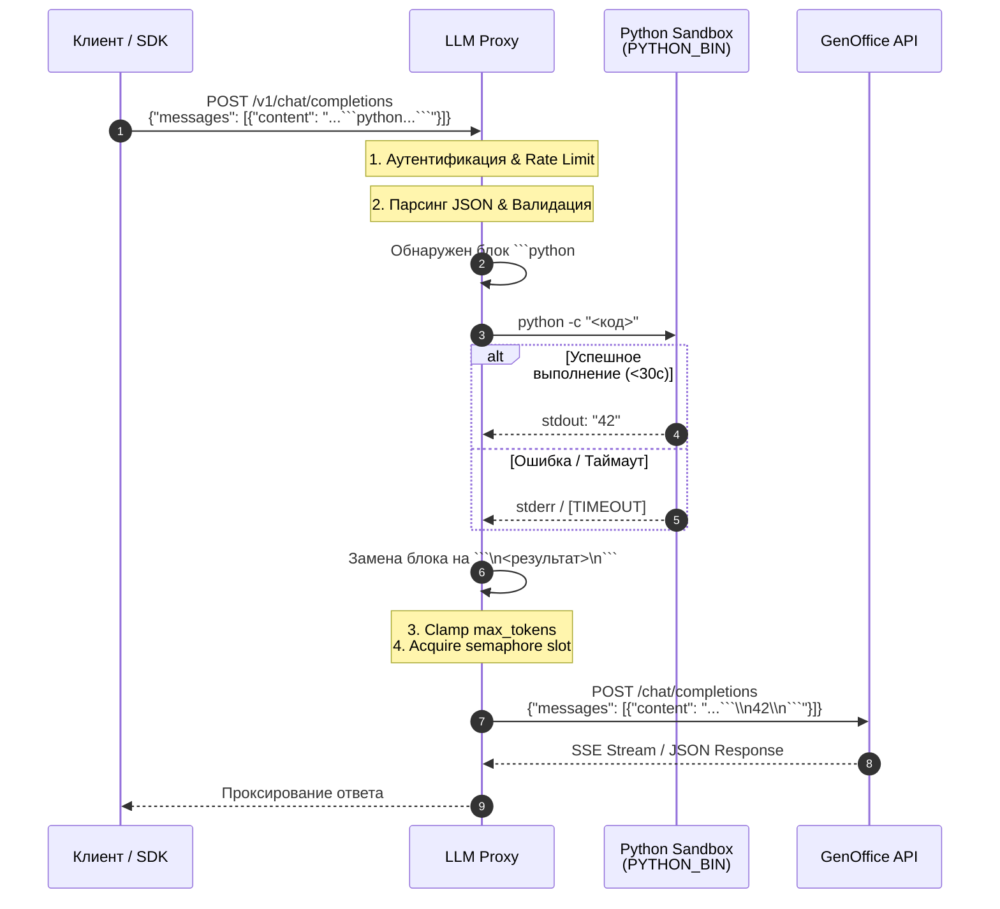

## Комплект артефактов для интеграции исполнения Python-кода через GenOffice. 

### 1. Схема архитектуры (Mermaid)

Диаграмма отражает поток данных с учётом того, что **исполнение кода происходит на стороне прокси до отправки запроса в LLM**. Это критически важное архитектурное решение: модель получает уже готовый результат вычислений, а не генерирует код «вслепую».



### 2. Определение Skill для GenOffice

В экосистеме GenOffice «скилл» — это декларативное описание способности, которое регистрируется в системном промпте или метаданных агента. Поскольку исполнение кода берет на себя прокси, скилл описывает **контракт**, а не механику.

```yaml
skill:
  id: "code-interpreter-proxy"
  name: "Python Code Execution (Proxy-Side)"
  version: "1.0.0"
  description: >
    Выполняет Python-код синхронно перед отправкой запроса в LLM.
    Код должен быть самодостаточным (без внешних зависимостей),
    детерминированным и укладываться в 30 секунд выполнения.
    Результат автоматически подставляется в контекст диалога.

  contract:
    input_format: "fenced-code-block"
    language_tag: "python"
    max_execution_time_sec: 30
    sandbox_isolation: true
    network_access: false
    filesystem_access: read-only-tmp

  limitations:
    - "Запрещены сетевые вызовы (requests, urllib, socket)"
    - "Запрещена запись в файловую систему вне /tmp"
    - "Максимальный размер вывода: 64 КиБ"
    - "Нет сохранения состояния между запросами"
    - "Вложенные fenced-блоки не поддерживаются"

  error_handling:
    timeout: "[TIMEOUT] Код выполнялся дольше 30 секунд"
    syntax_error: "[ERROR exit=1]\n<stderr>"
    spawn_failure: "[SPAWN ERROR] Интерпретатор недоступен"
    disabled: "Блоки ```python передаются в LLM без изменений"
```

### 3. Примеры промптов

#### Базовое вычисление

**Запрос клиента:**
```json
{
  "model": "gpt-4o-mini",
  "messages": [
    {
      "role": "system",
      "content": "Ты ассистент по анализу данных. Когда нужны точные вычисления, используй блок ```python. Результат будет подставлен автоматически."
    },
    {
      "role": "user",
      "content": "Рассчитай сложную процентную ставку: вклад 1_500_000 ₽ под 18.5% годовых с ежемесячной капитализацией на 3 года. Покажи код расчёта и итоговую сумму.\n\n```python\nprincipal = 1_500_000\nrate = 0.185\nmonths = 36\nresult = principal * (1 + rate/12)**months\nprint(f'{result:,.2f}')\n```"
    }
  ]
}
```

**Что получит GenOffice (после обработки прокси):**
```json
{
  "messages": [
    {
      "role": "system",
      "content": "Ты ассистент по анализу данных..."
    },
    {
      "role": "user",
      "content": "Рассчитай сложную процентную ставку... Покажи код расчёта и итоговую сумму.\n\n```\n2,579,841.63\n```"
    }
  ]
}
```

Модель видит **готовый ответ** и может сразу дать интерпретацию, не рискуя ошибиться в арифметике.

#### Обработка ошибки

**Запрос клиента:**
```
Проанализируй этот код:

```python
import nonexistent_library
print(nonexistent_library.compute())
```


**Что получит GenOffice:**
```
Проанализируй этот код:

```
[ERROR exit=1]
Traceback (most recent call last):
  File "<string>", line 1, in <module>
ModuleNotFoundError: No module named 'nonexistent_library'
```
```

Модель получает диагностический вывод и может объяснить ошибку пользователю.

### 4. Таблица соответствия состояний

| Состояние | Что видит LLM | Рекомендация для system prompt |
|---|---|---|
| `PYTHON_BIN` не задан | Исходный `` ```python `` блок | «Код не выполняется, проверяй его ментально» |
| Успех | `` ```\n<stdout>\n``` `` | «Результат верифицирован, используй его» |
| Синтаксическая ошибка | `` ```\n[ERROR exit=1]\n<stderr>\n``` `` | «Исправь код и предложи пользователю исправленную версию» |
| Таймаут | `` ```\n[TIMEOUT] ...\n``` `` | «Код слишком тяжёлый, предложи оптимизацию» |
| Spawn error | `` ```\n[SPAWN ERROR] ...\n``` `` | «Инфраструктурная проблема, сообщи администратору» |

### ⚠️ Критические замечания по безопасности

1.  **Изоляция обязательна.** Текущая реализация `run_python` запускает процесс от имени пользователя прокси. Без песочницы (`nsjail`, Docker, gVisor) это **RCE-уязвимость**. Переменная `PYTHON_BIN` должна указывать на изолированный рантайм. Поэтому "Безопасный"  :) -  устанавливайте прокси только  на клиентах!!!. 
2.  **Синхронность.** Выполнение кода блокирует слот конкурентности на всё время работы (до 30 с). При высокой нагрузке code-execution запросами увеличьте `MAX_CONCURRENT` или вынесите исполнение в отдельный сервис с очередью.
3.  **Детерминизм.** Один и тот же промпт может давать разный результат при каждом запросе. Документируйте это поведение для пользователей GenOffice.
4.  **Отсутствие кэша.** Повторные идентичные блоки `` ```python `` исполняются заново. Для дорогих вычислений добавление в будущем LRU-кэша по хешу кода.
